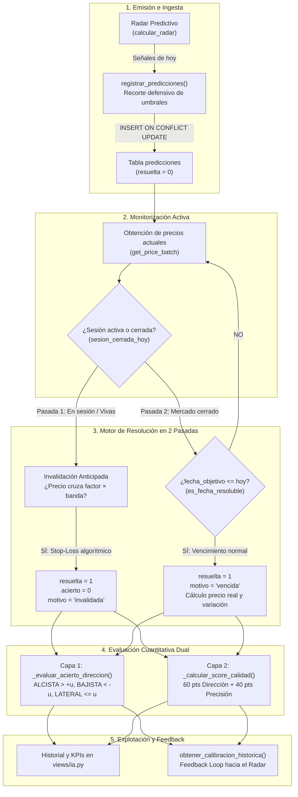

# 📜 INFORME TÉCNICO EXHAUSTIVO: HISTORIAL PREDICTIVO (STOCKLAB IA)
**Versión del Sistema:** `v4-institutional`  
**Módulos Clave:** [`database/predicciones.py`](file:///d:/Escritorio/stock-lab/database/predicciones.py), [`views/ia.py`](file:///d:/Escritorio/stock-lab/views/ia.py), [`utils/market_calendar.py`](file:///d:/Escritorio/stock-lab/utils/market_calendar.py), [`services/signal_engine.py`](file:///d:/Escritorio/stock-lab/services/signal_engine.py)  
**Destinatario:** Agente de IA / Ingeniero Cuantitativo de Sistemas de Predicción y Auditoría  
**Propósito:** Especificación técnica completa de arquitectura, esquema de persistencia, ciclo de vida de señales, algoritmos de resolución en doble pasada, sistema de scoring en doble capa, métricas agregadas y feedback loop empírico del Historial Predictivo.

---

## 1. RESUMEN EJECUTIVO Y FILOSOFÍA DEL SUBSISTEMA

El **Historial Predictivo** es el subsistema de auditoría cuantitativa, verificación de hipótesis y control de calidad algorítmico de StockLab. Su misión fundamental es transformar las señales proyectadas por el Radar en un **registro inmutable, verificable y auto-calibrable**.

A diferencia de los paneles tradicionales que simplemente descartan o sobreescriben predicciones pasadas, el Historial Predictivo opera bajo **5 principios de diseño institucional**:

1. **Desacoplamiento No-Intrusivo:** Gestiona su propio esquema SQLite independiente en [`stocklab.db`](file:///d:/Escritorio/stock-lab/stocklab.db) sin alterar las tablas operativas de la plataforma, inicializándose de forma perezosa (*lazy loading*).
2. **Inmutabilidad y Trazabilidad:** Una vez que una predicción se resuelve contra el precio real de mercado, el registro queda sellado de forma definitiva con su precio de cierre, error porcentual, motivo de resolución y puntuación de calidad.
3. **Liquidación Bursátil Estricta (BME / TARGET2):** Las señales no vencen por horas calendario aleatorias, sino siguiendo rigurosamente el **calendario bursátil oficial español**, respetando fines de semana, festivos de negociación y la subasta de cierre de las 17:35 CET.
4. **Doble Capa de Scoring (Zonas vs. Calidad):** Desglosa la evaluación en:
   - **Capa 1 (Acierto Binario):** Criterio estricto de superación de umbrales por horizonte ($\pm 0.8\%$ a $\pm 3.0\%$) para medir la tasa de acierto direccional pura.
   - **Capa 2 (Score de Calidad Continuo 0-100):** Medición ponderada de dirección ($60\%$) y exactitud de magnitud ($40\%$).
5. **Circuito de Realimentación Activo (Feedback Loop):** Los resultados del historial alimentan directamente al Radar en tiempo de inferencia, modulando dinámicamente el factor de confianza y los requisitos de consenso de cada activo según su predictibilidad histórica empírica.

---

## 2. ARQUITECTURA DE DATOS Y CICLO DE VIDA DE UNA PREDICCIÓN

El ciclo de vida de una predicción atraviesa 5 estados formales desde su emisión matinal hasta su consolidación en las métricas históricas:



---

## 3. ESQUEMA DE PERSISTENCIA Y MIGRACIONES (`database/predicciones.py`)

### 3.1. DDL de la Tabla `predicciones`
La tabla se define con una restricción de unicidad estricta para garantizar que nunca existan dos predicciones duplicadas para el mismo activo, horizonte y fecha de emisión:

```sql
CREATE TABLE IF NOT EXISTS predicciones (
    id                 INTEGER PRIMARY KEY AUTOINCREMENT,
    ticker             TEXT    NOT NULL,
    empresa            TEXT,
    fecha_prediccion   TEXT    NOT NULL,
    horizonte          TEXT    NOT NULL,
    dias               INTEGER NOT NULL,
    fecha_objetivo     TEXT    NOT NULL,
    senal              TEXT    NOT NULL,
    pct_estimado       REAL,
    banda_pct          REAL,
    confianza          REAL,
    precio_entrada     REAL    NOT NULL,
    score_motor        REAL,
    modelo             TEXT    NOT NULL DEFAULT 'v1-rules',
    resuelta           INTEGER NOT NULL DEFAULT 0,
    fecha_resolucion   TEXT,
    precio_real        REAL,
    variacion_real     REAL,
    acierto            INTEGER,
    error_pct          REAL,
    motivo_resolucion  TEXT,
    score_calidad      REAL,
    UNIQUE(ticker, horizonte, fecha_prediccion) ON CONFLICT IGNORE
);
```

### 3.2. Diccionario de Datos de la Tabla

| Columna | Tipo | Nullable | Descripción y Rango |
| :--- | :---: | :---: | :--- |
| `id` | `INTEGER` | NO | Clave primaria autoincremental única. |
| `ticker` | `TEXT` | NO | Símbolo oficial de cotización en BME (ej. `'BBVA.MC'`, `'ITX.MC'`). |
| `empresa` | `TEXT` | SÍ | Nombre descriptivo comercial de la compañía cotizada. |
| `fecha_prediccion` | `TEXT` | NO | Fecha ISO (`YYYY-MM-DD`) en la que el Radar emitió la señal. |
| `horizonte` | `TEXT` | NO | Código de horizonte: `'1D'`, `'3D'`, `'1S'`, `'1M'`. |
| `dias` | `INTEGER` | NO | Número de sesiones bursátiles del horizonte ($1, 3, 5, 20$). |
| `fecha_objetivo` | `TEXT` | NO | Fecha ISO (`YYYY-MM-DD`) exacta de vencimiento hábil BME. |
| `senal` | `TEXT` | NO | Dirección proyectada: `'ALCISTA'`, `'LATERAL'`, `'BAJISTA'`. |
| `pct_estimado` | `REAL` | SÍ | Variación porcentual estimada ($\pm\%$), coherente con umbrales. |
| `banda_pct` | `REAL` | SÍ | Volatilidad esperada del activo en el horizonte ($\pm\%$). |
| `confianza` | `REAL` | SÍ | Nivel de confianza algorítmica ($50.0\%$ a $99.0\%$). |
| `precio_entrada` | `REAL` | NO | Precio de cotización (€) en el momento de emitir la predicción. |
| `score_motor` | `REAL` | SÍ | Puntuación continua $[-2.0, +2.0]$ producida por el motor. |
| `modelo` | `TEXT` | NO | Versión del motor emisor (actualmente `'v4-institutional'`). |
| `resuelta` | `INTEGER`| NO | Flag de estado: `0` = En seguimiento activo, `1` = Liquidada. |
| `fecha_resolucion` | `TEXT` | SÍ | Fecha ISO (`YYYY-MM-DD`) efectiva en la que se cerró la señal. |
| `precio_real` | `REAL` | SÍ | Precio real de cierre (€) contra el que se auditó la señal. |
| `variacion_real` | `REAL` | SÍ | Retorno real observado: $\frac{P_{\text{real}} - P_{\text{entrada}}}{P_{\text{entrada}}} \times 100$. |
| `acierto` | `INTEGER`| SÍ | Resultado binario: `1` = Acierto de dirección en zona, `0` = Fallo. |
| `error_pct` | `REAL` | SÍ | Error absoluto de magnitud: $|\text{pct\_estimado} - \text{variacion\_real}|$. |
| `motivo_resolucion`| `TEXT` | SÍ | Causa de cierre: `'vencida'` (normal) o `'invalidada'` (stop-loss). |
| `score_calidad` | `REAL` | SÍ | Puntuación integral continua de calidad ($0.0$ a $100.0$). |

### 3.3. Inicialización Idempotente y Migraciones Automáticas (`init_predicciones_table`)
Cada vez que arranca la aplicación o se accede a la vista de IA, se ejecuta [`init_predicciones_table()`](file:///d:/Escritorio/stock-lab/database/predicciones.py#L85), la cual garantiza:
1. **Evolución del Esquema:** Añade dinámicamente columnas como `motivo_resolucion` y `score_calidad` mediante `ALTER TABLE` si no existían en versiones previas de la base de datos.
2. **Backfill de Metadatos:** Asigna automáticamente `'vencida'` a registros cerrados sin motivo y calcula el `score_calidad` histórico.
3. **Armonización de Incoherencias:** Detecta registros históricos cuyo `pct_estimado` violaba los umbrales de zona y los recorta a los límites matemáticos del horizonte, actualizando el error y score en señales resueltas.
4. **Recálculo de Reglas Antiguas:** Si detecta registros evaluados bajo criterios obsoletos (como laterales evaluadas contra $\pm 1\sigma$ o señales alcistas resueltas con retornos $\le +0.8\%$), recalcula de forma masiva todas las resueltas aplicando la lógica institucional vigente.

---

## 4. REGISTRO E INGESTA DEFENSIVA (`registrar_predicciones`)

La función [`registrar_predicciones()`](file:///d:/Escritorio/stock-lab/database/predicciones.py#L192) recibe el DataFrame emitido por el Radar y efectúa el registro diario:

### 4.1. Calendario Bursátil y Fechas Objetivo Hábiles
Para calcular la fecha objetivo de cada horizonte, se invoca [`fecha_habil_bme()`](file:///d:/Escritorio/stock-lab/utils/market_calendar.py#L59), basada en el sistema europeo TARGET2 y BME:
- **Festivos Fijos Oficiales:**
  - 1 de Enero (Año Nuevo)
  - 1 de Mayo (Día del Trabajador)
  - 25 de Diciembre (Navidad)
  - 26 de Diciembre (San Esteban / Boxing Day)
- **Festivos Móviles de Pascua:**
  - Se calcula el Domingo de Resurrección mediante el **algoritmo anónimo de Butcher/Meeus**.
  - Viernes Santo: $\text{Pascua} - 2\text{ días}$.
  - Lunes de Pascua: $\text{Pascua} + 1\text{ día}$.
- **Cálculo de Sesiones Hábiles:**
  Se utilizan operaciones vectorizadas de `numpy` (`np.is_busday` y `np.busday_offset`) con el array de festivos. Si la predicción se emite en fin de semana o festivo, la primera sesión hábil futura actúa como sesión 1.

### 4.2. Defensa en Profundidad al Registrar
Antes de persistir cualquier fila en la base de datos, se ejecuta una verificación preventiva sobre `pct_estimado`:
```python
u_lat = UMBRALES_LATERAL.get(hz, 0.8)
if pct_val is not None:
    if senal_str == "LATERAL":
        pct_val = round(float(np.clip(pct_val, -u_lat, u_lat)), 2)
    elif senal_str == "ALCISTA" and pct_val < u_lat:
        pct_val = u_lat
    elif senal_str == "BAJISTA" and pct_val > -u_lat:
        pct_val = -u_lat
```
*Garantía:* Es imposible que se persista una predicción lateral fuera de rango o una direccional incoherente.

### 4.3. Upsert Idempotente Intradiario
La inserción utiliza una cláusula `ON CONFLICT(ticker, horizonte, fecha_prediccion) DO UPDATE`:
```sql
ON CONFLICT(ticker, horizonte, fecha_prediccion) DO UPDATE SET
    empresa = excluded.empresa,
    dias = excluded.dias,
    fecha_objetivo = excluded.fecha_objetivo,
    senal = excluded.senal,
    pct_estimado = excluded.pct_estimado,
    banda_pct = excluded.banda_pct,
    confianza = excluded.confianza,
    precio_entrada = excluded.precio_entrada,
    score_motor = excluded.score_motor,
    modelo = excluded.modelo
WHERE predicciones.resuelta = 0
```
Esto permite recalcular el Radar varias veces durante el mismo día (actualizando precios de entrada y modelos) **sin duplicar registros** y protegiendo de forma absoluta las predicciones que ya hubiesen sido resueltas (`resuelta = 0`).

---

## 5. MOTOR DE RESOLUCIÓN EN DOBLE PASADA (`resolver_predicciones`)

La función [`resolver_predicciones()`](file:///d:/Escritorio/stock-lab/database/predicciones.py#L346) se ejecuta diariamente antes de emitir nuevas señales o al cargar la plataforma. Se estructura en dos pasadas independientes:

### 5.1. Pasada 1: Invalidación Anticipada (Stop-Loss Algorítmico)
Se analizan las predicciones activas (`resuelta = 0`) cuya fecha objetivo aún no ha llegado:

- **Factores de Invalidación por Horizonte (`_INVALIDACION_FACTOR`):**
  - **1D:** `None` (el horizonte de 1 sesión es demasiado corto para invalidar anticipadamente).
  - **3D:** Factor $2.0 \times$ banda.
  - **1S:** Factor $1.5 \times$ banda.
  - **1M:** Factor $1.2 \times$ banda.
- **Umbral de Invalidación:**
  $$U_{\text{inv}} = \text{factor} \times \max(|\text{banda\_pct}|, 1.5\%)$$
- **Condición de Ruptura Catastrófica:**
  - Señal `ALCISTA`: Si $\text{variacion\_actual} < -U_{\text{inv}}$ (el precio se hunde en contra).
  - Señal `BAJISTA`: Si $\text{variacion\_actual} > +U_{\text{inv}}$ (el precio se dispara al alza).
  - Señal `LATERAL`: Si $|\text{variacion\_actual}| > U_{\text{inv}}$ (el precio rompe con violencia el rango).
- **Acción de Cierre Forzado:**
  La posición se liquida inmediatamente:
  - `resuelta = 1`
  - `acierto = 0` (fallo garantizado por stop)
  - `motivo_resolucion = 'invalidada'`
  - `fecha_resolucion = fecha_actual`
  - `score_calidad`: Se calcula con la fórmula continua, otorgando 0 puntos de dirección y puntuando únicamente la proximidad residual en precisión.

### 5.2. Pasada 2: Liquidación por Vencimiento Normal
Se procesan las predicciones que han alcanzado su fecha de madurez:

- **Criterio de Cierre Oficial (`sesion_cerrada_hoy`):**
  Una predicción con `fecha_objetivo == hoy` **solo** se liquida si la sesión de BME ha finalizado oficialmente ($\ge 17:35$ hora de Madrid con subasta completada) o si hoy es fin de semana/festivo. Si la sesión sigue en curso, la predicción permanece viva hasta el cierre oficial para evitar liquidar con precios intermedios volátiles.
- **Cálculo del Retorno Real:**
  $$\text{variacion\_real} = \frac{Precio_{\text{cierre\_real}} - Precio_{\text{entrada}}}{Precio_{\text{entrada}}} \times 100.0$$
- **Acción de Cierre Normal:**
  - `resuelta = 1`
  - `motivo_resolucion = 'vencida'`
  - `fecha_resolucion = fecha_actual`
  - `acierto`: Calculado por la Capa 1 de scoring.
  - `score_calidad`: Calculado por la Capa 2 de scoring.

---

## 6. SISTEMA DE SCORING EN DOBLE CAPA

### 6.1. CAPA 1: EVALUACIÓN BINARIA POR ZONAS (`_evaluar_acierto_direccion`)

Determina si la predicción acertó o falló la dirección prevista. Es el valor binario ($1$ ó $0$) que alimenta la **Tasa de Acierto Global e Individual**.

La evaluación se rige por la tabla de **Umbrales de Zona Lateral (`UMBRALES_LATERAL`)**:
- **1 Día (1D):** Umbral $\pm 0.8\%$
- **3 Días (3D):** Umbral $\pm 1.2\%$
- **1 Semana (1S):** Umbral $\pm 1.8\%$
- **1 Mes (1M):** Umbral $\pm 3.0\%$

#### Reglas de Decisión Matemática:
$$\text{Acierto}(\text{ALCISTA}) = \begin{cases} 1 & \text{si } \text{variacion\_real} > +u \\ 0 & \text{en caso contrario} \end{cases}$$

$$\text{Acierto}(\text{BAJISTA}) = \begin{cases} 1 & \text{si } \text{variacion\_real} < -u \\ 0 & \text{en caso contrario} \end{cases}$$

$$\text{Acierto}(\text{LATERAL}) = \begin{cases} 1 & \text{si } |\text{variacion\_real}| \le u \\ 0 & \text{en caso contrario} \end{cases}$$

*Robustez Implementada:* La función tolera minúsculas, espacios accidentales y valores nulos/NaNs (devolviendo `0` ante datos de precio no finitos).

---

### 6.2. CAPA 2: SCORE DE CALIDAD CONTINUO 0-100 (`_calcular_score_calidad`)

A diferencia de la tasa binaria, el **Score de Calidad** premia la exactitud cuantitativa de la magnitud y discrimina entre fallos catastróficos y aciertos quirúrgicos:

$$\text{Score de Calidad} = \text{Puntos de Dirección } (0 \text{ ó } 60) + \text{Puntos de Precisión de Magnitud } (0 \text{ a } 40)$$

#### A) Componente de Dirección (60 puntos)
$$\text{pts\_dir} = 60.0 \times \text{Acierto}$$
Si la dirección de la señal en zona fue correcta, se otorgan 60 puntos base; si falló la dirección o fue invalidada, recibe 0 puntos base.

#### B) Componente de Precisión de Magnitud (0 a 40 puntos)
Mide cuán cerca se quedó el precio real de la estimación matemática:
$$\text{error} = |\text{pct\_estimado} - \text{variacion\_real}|$$
$$\text{referencia} = \max(|\text{banda\_pct}|, 1.5\%)$$
$$\text{pts\_precision} = 40.0 \times \max\left(0.0, 1.0 - \frac{\text{error}}{3.0 \times \text{referencia}}\right)$$

*(El suelo de $1.5\%$ en la referencia previene divisiones por cero en activos con volatilidad extremadamente baja).*

#### Matriz de Ejemplos Representativos (Predicción ALCISTA, Est. +3.0%, Banda ±2.0%):

| Variación Real Observada | Acierto Capa 1 | Pts Dirección | Error Absoluto | Pts Precisión | **Score Final (0-100)** | Diagnóstico Técnico |
| :---: | :---: | :---: | :---: | :---: | :---: | :--- |
| **+2.90%** | **1** (Acierto) | 60.0 | 0.10% | 39.3 | **99.3** | Acierto excelente, estimación casi exacta. |
| **+1.50%** | **1** (Acierto) | 60.0 | 1.50% | 30.0 | **90.0** | Acierto claro, menor recorrido del proyectado. |
| **+0.85%** | **1** (Acierto) | 60.0 | 2.15% | 25.7 | **85.7** | Acierto de zona en el umbral, magnitud floja. |
| **+0.40%** | **0** (Fallo) | 0.0 | 2.60% | 22.7 | **22.7** | Fallo de zona (quedó lateral), pero subió algo. |
| **-1.00%** | **0** (Fallo) | 0.0 | 4.00% | 13.3 | **13.3** | Fallo direccional, caída moderada. |
| **-6.00%** | **0** (Fallo) | 0.0 | 9.00% | 0.0 | **0.0** | Fallo total en contra (movimiento destructivo). |

---

## 7. MOTOR DE CONSULTA Y MÉTRICAS AGREGADAS (`obtener_metricas`)

La función [`obtener_metricas()`](file:///d:/Escritorio/stock-lab/database/predicciones.py#L554) realiza un análisis agregado en SQLite en milisegundos:

### Fórmulas de las Métricas Consolidadas:
1. **Total de Señales Auditadas:**
   $$\text{Total} = \text{Resueltas} + \text{Vigentes Únicas}$$
2. **Tasa de Acierto Global (%):**
   $$\text{Tasa de Acierto} = \frac{\sum_{i=1}^{N_{\text{res}}} \text{acierto}_i}{N_{\text{res}}} \times 100.0$$
3. **Score Medio Global (0-100):**
   $$\text{Score Medio} = \frac{\sum_{i=1}^{N_{\text{res}}} \text{score\_calidad}_i}{N_{\text{res}}}$$
4. **Error Medio Porcentual (p.p.):**
   $$\text{Error Medio} = \frac{\sum_{i=1}^{N_{\text{res}}} \text{error\_pct}_i}{N_{\text{res}}}$$
5. **Señales Invalidadas:** Conteo de registros con `motivo_resolucion = 'invalidada'`.
6. **Desglose Multitemporal:** Genera un diccionario `{1D, 3D, 1S, 1M}` con número de muestras ($n$), aciertos y tasa específica por horizonte.

---

## 8. FEEDBACK LOOP CUANTITATIVO HACIA EL RADAR (`obtener_calibracion_historica`)

El Historial Predictivo cierra el círculo con el Radar a través de [`obtener_calibracion_historica()`](file:///d:/Escritorio/stock-lab/database/predicciones.py#L697). Ejecuta una consulta agrupada sobre la base de datos:

```sql
SELECT ticker, horizonte, COUNT(*), COALESCE(SUM(acierto), 0)
FROM predicciones
WHERE resuelta = 1
GROUP BY ticker, horizonte
```

### Reglas de Adaptación Cuantitativa ($n \ge 5$ muestras resueltas):
- **Predictibilidad Excelente ($\text{Tasa} \ge 80\%$):**
  - $\text{Factor de Confianza} = 1.15$ (+15% boost en confianza proyectada).
  - $\text{Ajuste de Consenso} = 0$.
- **Predictibilidad Fuerte ($\text{Tasa} \ge 70\%$):**
  - $\text{Factor de Confianza} = 1.10$ (+10% boost).
- **Predictibilidad Débil ($\text{Tasa} \le 48\%$):**
  - $\text{Factor de Confianza} = 0.90$ (-10% penalización).
- **Activo Errático / Impredecible ($\text{Tasa} \le 40\%$):**
  - $\text{Factor de Confianza} = 0.85$ (-15% penalización).
  - $\mathbf{\text{Ajuste de Consenso} = +1}$: Se exige consenso casi unánime (**4 de 4 componentes técnicos**) para que el motor se atreva a emitir una señal direccional sobre este activo.

---

## 9. INTERFAZ GRÁFICA Y CONTROL DE USUARIO (`views/ia.py`)

La sección 3 del panel de Inteligencia Artificial materializa el historial mediante componentes interactivos de alta fidelidad:

### 9.1. Fila de 5 Tarjetas KPI del Historial
- **Total Señales:** Número consolidado de señales registradas en el horizonte.
- **Resueltas:** Conteo de predicciones liquidadas contra precio real, desglosando cuántas fueron invalidadas por stop.
- **Tasa de Acierto:** Porcentaje de acierto direccional, coloreado dinámicamente en verde ($\ge 50\%$) o ámbar.
- **Score Medio:** Calidad técnica global ($0-100$), coloreado en verde ($\ge 70$), ámbar ($\ge 40$) o rojo ($< 40$).
- **En Seguimiento:** Total de señales activas vivas en el mercado.

### 9.2. Pestaña 1: Historial de Resueltas (`tab_res`)
1. **Desglose de Desempeño por Dirección:**
   Tres bloques informativos con conteo, tasa de acierto y rentabilidad media acumulada:
   - 🟢 **Alcistas:** Conteo, % de acierto y retorno medio capturado.
   - 🔴 **Bajistas:** Conteo, % de acierto y retorno neto inverso medio.
   - 🟡 **Laterales:** Conteo y % de acierto dentro del umbral exacto del horizonte (`±0.8%`, `±1.2%`, etc.).
2. **Tabla Interactiva de Auditoría:**
   Renderiza las columnas: `Fecha`, `Empresa`, `Horizonte`, `Señal`, `Entrada (€)`, `Cierre (€)`, `Est. (%)`, `Real (%)`, `Score (0-100)` y `Resultado` (`✅ Acierto`, `❌ Fallo` o `⚡ Invalidada`).
3. **Modal de Gestión y Vaciado (`_dialog_limpiar_historial`):**
   Permite al usuario purgar predicciones resueltas de forma irreversible (por horizonte o todas) con confirmación de seguridad en dos pasos, **sin tocar nunca las señales pendientes en seguimiento**.

### 9.3. Pestaña 2: En Seguimiento Activo (`tab_pend`)
1. **Monitorización Intradiaria en Tiempo Real:**
   Compara el precio de entrada de las predicciones vivas contra la última cotización descargada en el Radar, mostrando la variación latente intradiaria acumulada.
2. **Campos Monitorizados:**
   `Emisión`, `Empresa`, `Horizonte`, `Señal`, `Entrada (€)`, `Actual (€)`, `Var. (%)`, `Est. (%)`, `Vencimiento`.
3. **Modal de Recálculo (`_dialog_recalcular_predicciones`):**
   Permite eliminar exclusivamente las predicciones pendientes (`resuelta = 0`) para forzar que el Radar recalcule señales frescas con el modelo actual al recargar la página.

---

## 10. DICCIONARIO MAESTRO DE CONSTANTES Y PARÁMETROS DEL HISTORIAL

| Constante / Parámetro | Valor por Defecto | Archivo | Rol en el Historial |
| :--- | :---: | :--- | :--- |
| `MODELO_VERSION` | `'v4-institutional'` | `predicciones.py` | Etiqueta de versión del modelo persistida en cada predicción. |
| `UMBRALES_LATERAL` | `{"1D": 0.8, "3D": 1.2, "1S": 1.8, "1M": 3.0}` | `predicciones.py` | Fronteras de zona porcentual ($\pm\%$) para evaluación de acierto. |
| `_HORIZONTES_DEFAULT` | `{"1D": 1, "3D": 3, "1S": 5, "1M": 20}` | `predicciones.py` | Mapeo de sesiones bursátiles por horizonte. |
| `_INVALIDACION_FACTOR`| `{"1D": None, "3D": 2.0, "1S": 1.5, "1M": 1.2}`| `predicciones.py` | Multiplicador de volatilidad para activación de stop-loss algorítmico. |
| `PTS_DIRECCION_MAX` | `60.0` | `predicciones.py` | Puntuación asignada a la dirección correcta en el Score de Calidad. |
| `PTS_PRECISION_MAX` | `40.0` | `predicciones.py` | Puntuación máxima por precisión de magnitud en el Score de Calidad. |
| `FLOOR_REFERENCIA` | `1.5%` | `predicciones.py` | Mínimo divisor de banda en la fórmula de precisión para evitar división por cero. |
| `HORA_CIERRE_BME` | `17:35 CET` | `market_calendar.py` | Hora oficial tras la cual se liquida una sesión por vencimiento normal. |

---

## 11. GUÍA PARA EL AGENTE DE IA REVISOR (PRÓXIMAS MEJORAS Y AUDITORÍA)

Para el agente de IA que analice este documento con el objetivo de plantear mejoras cuantitativas en el Historial Predictivo, se recomiendan los siguientes 5 vectores de desarrollo:

1. **Liquidación Intradiaria por MFE / MAE (Maximum Favorable/Adverse Excursion):**
   - Actualmente, las predicciones que no se invalidan se resuelven exclusivamente al precio de cierre final del día de vencimiento.
   - *Propuesta:* Registrar en la tabla el máximo precio favorable alcanzado durante la vida de la señal y el máximo adverso, permitiendo calcular ratios de captura de alfa y eficiencia de ejecución.
2. **Ponderación Bayesiana en el Feedback Loop:**
   - La calibración empírica actual utiliza un umbral rígido de corte en $n \ge 5$ muestras.
   - *Propuesta:* Implementar un estimador empírico bayesiano (Shrinkage / James-Stein) que contraiga la tasa observada hacia la media global del sector en activos con pocas muestras, evitando sobreajustes en activos con solo 5 o 6 observaciones.
3. **Métrica de Ratio Sharpe / Sortino Predictivo:**
   - Incorporar en las tarjetas KPI del historial no solo la tasa de acierto y score medio, sino el retorno medio ponderado por riesgo de las señales emitidas frente a una estrategia Buy & Hold en el IBEX 35.
4. **Curva de Decaimiento Temporal del Alfa:**
   - Analizar si las señales de 1 Semana y 1 Mes alcanzan su máxima rentabilidad en la mitad de su horizonte temporal (decay prematuro), lo que permitiría introducir tomas de beneficio algorítmicas dinámicas.
5. **Exportación Estructurada para Backtesting Cuantitativo:**
   - Añadir una función de volcado masivo en formato Apache Parquet o CSV con particionado temporal para facilitar el reentrenamiento de modelos externos de Machine Learning sobre el histórico de señales.

---
*Informe generado y verificado automáticamente con la suite de pruebas unitarias de StockLab.*
