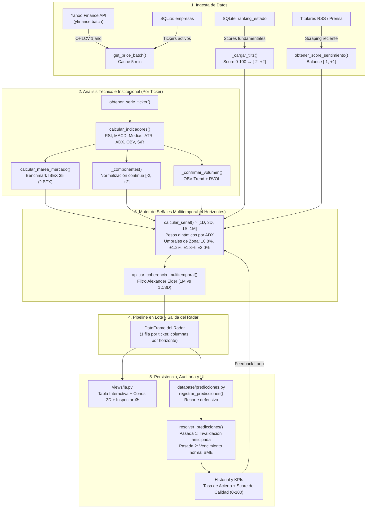

# 📡 INFORME TÉCNICO EXHAUSTIVO: RADAR PREDICTIVO (STOCKLAB IA)
**Versión del Sistema:** `v4-institutional`  
**Módulos Clave:** [`services/signal_engine.py`](file:///d:/Escritorio/stock-lab/services/signal_engine.py), [`database/predicciones.py`](file:///d:/Escritorio/stock-lab/database/predicciones.py), [`views/ia.py`](file:///d:/Escritorio/stock-lab/views/ia.py)  
**Destinatario:** Agente de IA / Ingeniero Cuantitativo de Sistemas de Predicción  
**Propósito:** Especificación técnica completa de arquitectura, fórmulas, orígenes de datos, flujos de cálculo, reglas de resolución y ciclo de vida de señales del Radar Predictivo.

---

## 1. RESUMEN EJECUTIVO Y FILOSOFÍA DEL SUBSISTEMA

El **Radar Predictivo** es el motor algorítmico y cuantitativo de StockLab encargado de generar, clasificar, calibrar y monitorizar señales de proyección de precios sobre activos cotizados en el mercado español continuo (BME).

A diferencia de los modelos de clasificación binaria convencionales (caja negra), el Radar Predictivo se diseñó bajo una **Arquitectura Ortogonal de 3 Capas** respaldada por **5 Mejoras de Rigor Institucional**:

1. **Ortogonalidad de Factores:** Dirección técnica, confirmación de volumen y filtros de régimen operan en capas separadas para evitar que el ruido o anomalías de una sola variable contaminen la estimación.
2. **Coherencia Matemática Estricta:** Las etiquetas cualitativas (`ALCISTA`, `LATERAL`, `BAJISTA`) y las estimaciones cuantitativas de variación porcentual (`pct_estimado`) son matemáticamente coherentes en todo momento, acotadas por **umbrales de zona escalados según el horizonte temporal**.
3. **Filtro Macro / Micro (Elder Triple Screen):** Las decisiones de corto plazo nunca operan en contra de la tendencia de orden superior (1 mes), mitigando trampas de mercado (*bull/bear traps*).
4. **Ciclo de Retroalimentación Empírico (Feedback Loop):** El motor no es estático; audita en tiempo real su tasa de acierto histórica en base de datos para auto-calibrar su nivel de confianza y endurecer los requisitos de consenso en activos erráticos.
5. **Doble Capa de Evaluación:** La resolución posterior de señales combina una evaluación binaria por zonas (para la Tasa de Acierto) con un **Score de Calidad continuo de 0 a 100** que pondera la dirección correcta ($60\%$) y la precisión de magnitud ($40\%$).

---

## 2. MAPA ARQUITECTÓNICO Y FLUJO DE DATOS END-TO-END

El flujo de información atraviesa 5 etapas secuenciales desde la captura de datos de mercado hasta la persistencia y renderizado:



---

## 3. FUENTES DE ENTRADA Y PREPARACIÓN DE DATOS

| Variable / Entrada | Origen del Dato | Frecuencia / TTL | Formato y Normalización |
| :--- | :--- | :--- | :--- |
| **Series OHLCV** | Yahoo Finance vía [`services/data_provider.py`](file:///d:/Escritorio/stock-lab/services/data_provider.py) | Caché 5 min (`ttl=300s`) | DataFrame con índice `DatetimeIndex`, columnas `Open`, `High`, `Low`, `Close`, `Volume`. Se exigen al menos **35 barras útiles** (`MIN_BARRAS = 35`). |
| **Benchmark IBEX 35** | Ticker `^IBEX` descargado en el mismo batch | Caché 5 min | Serie OHLCV del índice rector del mercado español. |
| **Tilt Fundamental** | Tabla `ranking_estado` en [`stocklab.db`](file:///d:/Escritorio/stock-lab/stocklab.db) | On-demand | Puntuación integral fundamental (0 a 100) mapeada a $[-2.0, +2.0]$ mediante: $\text{tilt} = \text{clip}\left(\frac{\text{score} - 50.0}{25.0}, -2.0, +2.0\right)$. Afecta únicamente al horizonte **1M**. |
| **Sentimiento de Noticias** | [`services/news_sentiment.py`](file:///d:/Escritorio/stock-lab/services/news_sentiment.py) | Caché 1 hora | Análisis de hasta 8 titulares recientes: $\text{score} = \frac{\text{positivas} - \text{negativas}}{\text{positivas} + \text{negativas}} \in [-1.0, +1.0]$. |
| **Historial Empírico** | Tabla `predicciones` en SQLite | 1 query SQL agregada | Matriz de calibración `(ticker, horizonte) -> {muestras, tasa_acierto, factor_confianza, ajuste_consenso}`. |

---

## 4. DETALLE DE LAS 3 CAPAS DEL MOTOR (`services/signal_engine.py`)

### 4.1. CAPA 1: DIRECCIÓN TÉCNICA Y COMPONENTES NORMALIZADOS

Cada indicador técnico se calcula en [`calcular_indicadores()`](file:///d:/Escritorio/stock-lab/services/signal_engine.py#L492) y se proyecta a un espacio continuo simétrico $[-2.0, +2.0]$ en [`_componentes()`](file:///d:/Escritorio/stock-lab/services/signal_engine.py#L597).

#### A) RSI de Wilder (14 periodos)
- **Cálculo:** Suavizado exponencial de Wilder ($\alpha = 1/14$):
  $$\text{Gain}_t = \max(\Delta P_t, 0), \quad \text{Loss}_t = \max(-\Delta P_t, 0)$$
  $$\text{AvgGain} = \text{EWM}(\text{Gain}, \alpha=1/14), \quad \text{AvgLoss} = \text{EWM}(\text{Loss}, \alpha=1/14)$$
  $$RS = \frac{\text{AvgGain}}{\text{AvgLoss}}, \quad RSI = 100 - \frac{100}{1 + RS}$$
- **Normalización a $[-2, +2]$:** El modelo trata el RSI como **momentum contextual**, no como contrarian ciego:
  $$C_{\text{RSI, base}} = \text{clip}\left(\frac{RSI - 50.0}{20.0}, -2.0, 2.0\right)$$
  Se añade una reversión suave únicamente en zonas de sobreextensión extrema:
  - Si $RSI < 20$: $C_{\text{RSI}} = C_{\text{RSI, base}} + 0.4 \times \frac{20 - RSI}{20}$ (potencial rebote).
  - Si $RSI > 80$: $C_{\text{RSI}} = C_{\text{RSI, base}} - 0.4 \times \frac{RSI - 80}{20}$ (potencial agotamiento).

#### B) Histograma MACD (12, 26, 9)
- **Cálculo:**
  $$MACD = \text{EMA}_{12}(Close) - \text{EMA}_{26}(Close), \quad \text{Signal} = \text{EMA}_{9}(MACD)$$
  $$\text{Histograma } h = MACD - \text{Signal}$$
- **Normalización Cross-Asset:** Para evitar que valores de precio nominal alto (como Aena a 190€ vs Tubacex a 3€) distorsionen el histograma, se normaliza por el **True Range diario (ATR)**:
  $$\text{norm} = Close \times \text{ATR}_d$$
  $$C_{\text{MACD}} = \text{clip}\left(\frac{h}{\text{norm}} \times 5.0, -2.0, 2.0\right)$$

#### C) Tendencia Estructural (SMA20, SMA50) + Bonus Cruce EMA 9/21
- **Cálculo:**
  - $\text{dist}_{20} = \frac{Close - \text{SMA}_{20}}{\text{SMA}_{20}} \times 100$
  - $\text{dist}_{50} = \frac{Close - \text{SMA}_{50}}{\text{SMA}_{50}} \times 100$
  - $\text{struct} = \frac{\text{SMA}_{20} - \text{SMA}_{50}}{\text{SMA}_{50}} \times 100$
  - $\text{raw\_tend} = 0.35 \times \text{dist}_{20} + 0.25 \times \text{dist}_{50} + 0.25 \times \text{struct}$
- **Bonus Cruce EMA 9/21:**
  Si en las últimas 3 sesiones hubo cruce alcista ($\text{EMA}_9 > \text{EMA}_{21}$ viniendo de abajo), bonus de $+0.3 \times 3.0 = +0.9$. Si fue bajista, $-0.9$.
- **Normalización:**
  $$C_{\text{tendencia}} = \text{clip}\left(\frac{\text{raw\_tend}}{3.0}, -2.0, 2.0\right)$$

#### D) Momentum Ponderado (5d y 20d) Normalizado por Volatilidad
- **Cálculo:** El retorno porcentual a 5 y 20 sesiones se transforma en un **z-score sobre la volatilidad esperada** ($\sigma \sqrt{t}$), impidiendo que valores hiper-volátiles saturen el componente:
  $$\sigma_5 = \text{vol}_d \times \sqrt{5} \times 100, \quad \sigma_{20} = \text{vol}_d \times \sqrt{20} \times 100$$
  $$Z_{\text{mom5}} = \frac{\text{ROC}_5}{\sigma_5}, \quad Z_{\text{mom20}} = \frac{\text{ROC}_{20}}{\sigma_{20}}$$
- **Normalización:**
  $$C_{\text{momentum}} = 0.6 \times \text{clip}(Z_{\text{mom5}}, -2, 2) + 0.4 \times \text{clip}(Z_{\text{mom20}}, -2, 2)$$

---

### 4.2. CAPA 2: CONFIRMACIÓN INSTITUCIONAL DE VOLUMEN

Implementada en [`_confirmar_volumen()`](file:///d:/Escritorio/stock-lab/services/signal_engine.py#L165). La dirección técnica no es operativa a nivel institucional si no cuenta con respaldo de volumen transaccional.

1. **Tendencia del On-Balance Volume (OBV):**
   $$\text{OBV}_t = \text{OBV}_{t-1} + \text{sign}(\Delta Close_t) \times Volume_t$$
   Se calcula la pendiente mediante regresión lineal por mínimos cuadrados ($y = mx + b$) en las últimas 10 sesiones, normalizada por la media de volumen a 20 días.
2. **Volumen Relativo (RVOL):**
   $$\text{RVOL} = \frac{\text{Volumen Última Sesión}}{\text{Media}(\text{Volumen 20 Sesiones Previas})}$$
3. **Multiplicador de Confirmación $V_{\text{confirm}}$:**
   - **Confirmación plena:** Si signo(pendiente OBV) coincide con signo($Score_{\text{dirección}}$):
     - Si $\text{RVOL} \ge 1.5 \implies V_{\text{confirm}} = 1.10$ (+10% boost).
     - Si $1.0 \le \text{RVOL} < 1.5 \implies V_{\text{confirm}} = 1.0 + 0.05 \times (\text{RVOL} - 1.0)$.
     - Si $\text{RVOL} < 1.0 \implies V_{\text{confirm}} = 1.00$.
   - **Divergencia (volumen contradice la señal):**
     - Si $\text{RVOL} \ge 1.5 \implies V_{\text{confirm}} = 0.70$ (-30% dampening severo).
     - Si $1.0 \le \text{RVOL} < 1.5 \implies V_{\text{confirm}} = 0.85$.
     - Si $\text{RVOL} < 1.0 \implies V_{\text{confirm}} = 0.90$.

---

### 4.3. CAPA 3: RÉGIMEN, FILTROS Y EXTENSIONES INSTITUCIONALES

#### A) Pesos Dinámicos según ADX (Detección de Régimen)
El ADX de Wilder (14 periodos) determina el régimen de mercado:
- $ADX > 25$: Mercado tendencial fuerte $\to$ los pesos priorizan **Tendencia y Momentum**; el RSI pierde peso.
- $ADX < 20$: Mercado lateral / en rango $\to$ los pesos priorizan **RSI y Reversión**; el momentum se reduce.
- $20 \le ADX \le 25$: Zona transicional $\to$ interpolación lineal continua $\alpha = \frac{ADX - 20}{5}$.

| Horizonte | Régimen Rango ($ADX < 20$) [RSI / MACD / TEND / MOM] | Régimen Tendencia ($ADX > 25$) [RSI / MACD / TEND / MOM] |
| :---: | :---: | :---: |
| **1D** | 0.30 / 0.30 / 0.20 / 0.20 | 0.05 / 0.25 / 0.30 / 0.40 |
| **3D** | 0.25 / 0.25 / 0.25 / 0.25 | 0.05 / 0.20 / 0.30 / 0.45 |
| **1S** | 0.20 / 0.20 / 0.30 / 0.30 | 0.05 / 0.15 / 0.35 / 0.45 |
| **1M** | 0.15 / 0.15 / 0.35 / 0.35 | 0.05 / 0.10 / 0.35 / 0.50 |

#### B) Marea de Mercado (Benchmark IBEX 35 - `^IBEX`)
Aproximadamente el $75\%$ de los activos siguen la dirección del índice rector.
- Si el IBEX está alcista ($S_{\text{marea}} \ge 0.25$): las señales bajistas se amortiguan un $15\%$ y se exige consenso estricto de **4 componentes** para emitir señal bajista.
- Si el IBEX está bajista ($S_{\text{marea}} \le -0.25$): las señales alcistas se amortiguan un $15\%$ y se exige consenso estricto de **4 componentes** para emitir señal alcista.

#### C) Fuerza Relativa vs IBEX (Mansfield / Minervini RS)
En horizontes tácticos (**3D** y **1S**), el diferencial de fuerza relativa a 20 sesiones modula el score final:
$$RS_{\text{diff}} = \text{ROC}_{20}(\text{Activo}) - \text{ROC}_{20}(\text{IBEX})$$
$$RS_{\text{score}} = \text{clip}\left(\frac{RS_{\text{diff}}}{10.0}, -1.0, 1.0\right)$$
Si $|RS_{\text{score}}| \ge 0.20$, se inyecta $+0.15 \times RS_{\text{score}}$ al score final.

#### D) Sentimiento de Titulares de Noticias Recientes
En horizontes ultra-cortos (**1D** y **3D**), el sentimiento de prensa reciente modula el score:
- En **1D**: $+0.15 \times \text{sentiment\_score}$ (si $|score| \ge 0.25$).
- En **3D**: $+0.10 \times \text{sentiment\_score}$ (si $|score| \ge 0.25$).

#### E) Sesgo de Soporte y Resistencia (Pivots Locales)
Detecta máximos y mínimos relativos en ventana de 5 sesiones. Si el precio está a menos del $1\%$ de una resistencia, inyecta `sr_bias` negativo (hasta $-0.3$) para frenar compras en techos. Si está a menos del $1\%$ de un soporte, inyecta `sr_bias` positivo.

#### F) Bollinger Squeeze
Si el ancho de bandas ($\text{Bandwidth} = \frac{\text{Upper} - \text{Lower}}{\text{SMA}} \times 100$) cae por debajo del $75\%$ de su media móvil de 20 periodos, se detecta compresión de volatilidad. Un squeeze activo no cambia la dirección, pero **suma +5% a la Confianza** si la señal ya es direccional.

#### G) Tilt Fundamental (Horizonte 1M)
En el horizonte mensual, el score técnico se combina con el tilt fundamental ($20\%$ de peso):
$$S_{\text{1M}} = S_{\text{1M}} \times 0.80 + \text{tilt\_fundamental} \times 0.20$$

---

## 5. SISTEMA DE ESTIMACIÓN Y UMBRALES DE ZONA POR HORIZONTE

El cálculo final de la señal direccional, la estimación porcentual y la banda de volatilidad en [`calcular_senal()`](file:///d:/Escritorio/stock-lab/services/signal_engine.py#L681) opera de la siguiente manera:

### 5.1. Amplitud de Banda y Proyección Base
1. **Volatilidad de Base:** Se utiliza el $\text{ATR}_d$ (Average True Range normalizado como fracción del precio) para capturar gaps nocturnos.
2. **Banda de Volatilidad a $N$ días:**
   $$\text{banda\_pct} = \text{volatilidad} \times \sqrt{\text{días}} \times 100.0$$
3. **Porcentaje Estimado Bruto:**
   $$pct = \left(\frac{S_{\text{final}}}{2.0}\right) \times \text{banda\_pct}, \quad \text{acotado en } [-2.0 \times \text{banda}, +2.0 \times \text{banda}]$$

### 5.2. Asignación de Etiqueta Cualitativa
- **Umbral de Activación Direccional:** $|S_{\text{final}}| \ge 0.60$ (`UMBRAL_SENAL = 0.60`).
- **Consenso Mínimo Requerido:** Mínimo 3 de 4 componentes alineados con signo $> 0.15$ o $< -0.15$ (o 4 si la marea o el historial lo exigen).
  - Si $S_{\text{final}} \ge 0.60$ y $n_{\text{alcista}} \ge \text{min\_consenso} \implies \mathbf{ALCISTA}$.
  - Si $S_{\text{final}} \le -0.60$ y $n_{\text{bajista}} \ge \text{min\_consenso} \implies \mathbf{BAJISTA}$.
  - En cualquier otro caso $\implies \mathbf{LATERAL}$.

### 5.3. Tabla Maestra de Umbrales de Zona (`UMBRALES_LATERAL`)
Para garantizar que una señal lateral no estime movimientos desproporcionados y que una señal alcista/bajista nunca estime valores dentro del rango lateral, los umbrales se escalan según el horizonte temporal:

| Código | Horizonte | Días Hábiles BME | Umbral de Zona Lateral ($\pm\%$) | Condición ALCISTA | Condición LATERAL | Condición BAJISTA |
| :---: | :---: | :---: | :---: | :---: | :---: | :---: |
| **1D** | 1 Día | 1 sesión | **$\pm 0.8\%$** | $> +0.8\%$ | $[-0.8\%, +0.8\%]$ | $< -0.8\%$ |
| **3D** | 3 Días | 3 sesiones | **$\pm 1.2\%$** | $> +1.2\%$ | $[-1.2\%, +1.2\%]$ | $< -1.2\%$ |
| **1S** | 1 Semana | 5 sesiones | **$\pm 1.8\%$** | $> +1.8\%$ | $[-1.8\%, +1.8\%]$ | $< -1.8\%$ |
| **1M** | 1 Mes | 20 sesiones | **$\pm 3.0\%$** | $> +3.0\%$ | $[-3.0\%, +3.0\%]$ | $< -3.0\%$ |

### 5.4. Regla de Armonización Etiqueta $\leftrightarrow$ Estimación
Inmediatamente tras determinar la señal, se ejecuta el ajuste de coherencia:
```python
umbral_lat = UMBRALES_LATERAL.get((horizonte or "").upper().strip(), 0.8)
if senal == SENAL_LATERAL:
    pct = round(float(np.clip(pct, -umbral_lat, umbral_lat)), 2)
elif senal == SENAL_ALCISTA and pct < umbral_lat:
    pct = umbral_lat
elif senal == SENAL_BAJISTA and pct > -umbral_lat:
    pct = -umbral_lat
```
*Garantía Matemática:* Una predicción `LATERAL` **nunca** superará el umbral del horizonte; una predicción `ALCISTA` **siempre** estimará al menos $+u\%$; y una predicción `BAJISTA` **siempre** estimará al menos $-u\%$.

---

## 6. FILTRO DE COHERENCIA MULTI-TEMPORAL (TRIPLE SCREEN DE ALEXANDER ELDER)

Implementado en [`aplicar_coherencia_multitemporal()`](file:///d:/Escritorio/stock-lab/services/signal_engine.py#L856). Conecta las 4 señales generadas para un activo:

1. **Regla 1 (Bloqueo Bajista Macro):**
   Si la señal mensual (**1M**) es `BAJISTA`:
   - Las señales tácticas de corto plazo (**1D** y **3D**) **no pueden ser ALCISTAS**, a menos que el $RSI < 25$ (rebote técnico por sobreventa extrema).
   - Si $RSI \ge 25$, la señal se degrada forzosamente a `LATERAL`, su convicción pasa a `BAJA` y su `pct` se recorta al umbral lateral de su horizonte ($\pm 0.8\%$ o $\pm 1.2\%$).
2. **Regla 2 (Bloqueo Alcista Macro):**
   Si la señal mensual (**1M**) es `ALCISTA`:
   - Las señales tácticas (**1D** y **3D**) **no pueden ser BAJISTAS**, a menos que el $RSI > 75$ (agotamiento extremo).
   - Si $RSI \le 75$, se degradan forzosamente a `LATERAL` y su `pct` se recorta al umbral.
3. **Regla 3 (Alineación Perfecta):**
   Si **1D**, **1S** y **1M** apuntan al unísono en la misma dirección (`ALCISTA` o `BAJISTA`), se otorga un **bonus de +5% de Confianza** en todos los horizontes por alineación de marea completa.

---

## 7. NIVELES DE CONVICCIÓN Y FEEDBACK LOOP ADAPTATIVO

### 7.1. Niveles de Convicción
- **ALTA:** Señal direccional (`ALCISTA` o `BAJISTA`) + $n_{\text{alineados}} \ge 4$ componentes + confirmación de volumen $V_{\text{confirm}} \ge 1.0$.
- **MEDIA:** Señal direccional + $n_{\text{alineados}} \ge 3$ componentes + $V_{\text{confirm}} \ge 0.85$.
- **BAJA:** Señal `LATERAL` o señal direccional débil sin confirmación.

### 7.2. Calibración Adaptativa por Historial Empírico
El motor invoca [`obtener_calibracion_historica()`](file:///d:/Escritorio/stock-lab/database/predicciones.py#L697), que ejecuta un `GROUP BY ticker, horizonte` sobre las predicciones resueltas en la base de datos:
- Si un activo en un horizonte tiene $\ge 5$ muestras:
  - $\text{Tasa de Acierto} \ge 80\% \implies \text{Factor Confianza} = 1.15$.
  - $\text{Tasa de Acierto} \ge 70\% \implies \text{Factor Confianza} = 1.10$.
  - $\text{Tasa de Acierto} \le 40\% \implies \text{Factor Confianza} = 0.85$ y **ajuste de consenso +1** (se exige consenso casi unánime para emitir señal a valores que históricamente fallan).
  - $\text{Tasa de Acierto} \le 48\% \implies \text{Factor Confianza} = 0.90$.

---

## 8. PIPELINE EN LOTE DEL RADAR (`calcular_radar`)

La función [`calcular_radar()`](file:///d:/Escritorio/stock-lab/services/signal_engine.py#L941) coordina la ejecución masiva para todo el universo de tickers en una sola pasada:

1. **Descarga y Benchmark:** Descarga el batch consolidado con `^IBEX`. Evalúa la marea de mercado una sola vez.
2. **Carga Agregada de Feedback:** Ejecuta 1 sola query SQL para obtener el mapa de calibración de todos los activos.
3. **Bucle de Activos:**
   - Extrae serie OHLCV con [`obtener_serie_ticker()`](file:///d:/Escritorio/stock-lab/services/signal_engine.py#L916).
   - Calcula indicadores y sentimiento de noticias.
   - Evalúa Capa 2 (volumen) a nivel ticker.
   - Itera los 4 horizontes (`1D`, `3D`, `1S`, `1M`) aplicando pesos dinámicos y calibraciones.
   - Aplica el filtro multi-temporal Elder Triple Screen.
4. **Estructura del DataFrame Resultante:**
   - **Metadatos y Técnicos:** `ticker`, `empresa`, `precio`, `var_dia`, `rsi`, `mom5`, `mom20`, `macd_h`, `vol_d`, `adx`, `rvol`, `marea`, `rs_ibex`, `regimen`.
   - **Por cada horizonte (`XX` $\in$ {1D, 3D, 1S, 1M}):**
     - `senal_XX`: Etiqueta (`ALCISTA`, `LATERAL`, `BAJISTA`).
     - `score_XX`: Score numérico combinado $[-2.0, +2.0]$.
     - `pct_XX`: Porcentaje estimado coherente con los umbrales de zona.
     - `conf_XX`: Porcentaje de confianza calibrado ($50\%$ a $99\%$).
     - `banda_XX`: Anchura de volatilidad esperada $\pm\%$.
     - `conv_XX`: Nivel de convicción (`ALTA`, `MEDIA`, `BAJA`).

---

## 9. PERSISTENCIA Y RESOLUCIÓN EN BASE DE DATOS (`database/predicciones.py`)

### 9.1. Esquema de la Tabla `predicciones`
```sql
CREATE TABLE IF NOT EXISTS predicciones (
    id                 INTEGER PRIMARY KEY AUTOINCREMENT,
    ticker             TEXT    NOT NULL,
    empresa            TEXT,
    fecha_prediccion   TEXT    NOT NULL,
    horizonte          TEXT    NOT NULL,
    dias               INTEGER NOT NULL,
    fecha_objetivo     TEXT    NOT NULL,
    senal              TEXT    NOT NULL,
    pct_estimado       REAL,
    banda_pct          REAL,
    confianza          REAL,
    precio_entrada     REAL    NOT NULL,
    score_motor        REAL,
    modelo             TEXT    NOT NULL DEFAULT 'v1-rules',
    resuelta           INTEGER NOT NULL DEFAULT 0,
    fecha_resolucion   TEXT,
    precio_real        REAL,
    variacion_real     REAL,
    acierto            INTEGER,
    error_pct          REAL,
    motivo_resolucion  TEXT,
    score_calidad      REAL,
    UNIQUE(ticker, horizonte, fecha_prediccion) ON CONFLICT IGNORE
);
```

### 9.2. Registro Defensivo (`registrar_predicciones`)
Cuando el radar genera las predicciones de la sesión de hoy:
- Se calculan las fechas objetivo mediante [`fecha_habil_bme()`](file:///d:/Escritorio/stock-lab/utils/market_calendar.py), respetando el calendario bursátil oficial de Bolsas y Mercados Españoles.
- Se aplica una **defensa en profundidad**: antes de insertar en la base de datos, se re-verifica que `pct_estimado` respeta el umbral de su horizonte. Si no lo hace, se recorta preventivamente.
- Cláusula `ON CONFLICT(ticker, horizonte, fecha_prediccion) DO UPDATE`: Permite recálculos intradiarios sin duplicar registros.

### 9.3. Proceso de Resolución en 2 Pasadas (`resolver_predicciones`)

#### Pasada 1: Invalidación Anticipada (Stop-Loss Algorítmico)
Se revisan las predicciones activas (`resuelta = 0`) cuya fecha objetivo aún no ha vencido:
- Factores de invalidación: `1D: None`, `3D: 2.0x banda`, `1S: 1.5x banda`, `1M: 1.2x banda`.
- Umbral de fallo catastrófico: $U_{\text{inv}} = \text{factor} \times \max(|\text{banda}|, 1.5\%)$.
- Si el precio se mueve en contra de la señal más allá de $U_{\text{inv}}$, la predicción se liquida de inmediato como:
  - `resuelta = 1`
  - `acierto = 0`
  - `motivo_resolucion = 'invalidada'`
  - `score_calidad`: Calculado con el error real (obteniendo entre 0 y 40 pts de precisión, pero 0 en dirección).

#### Pasada 2: Vencimiento Normal
Se liquidan las predicciones cuya `fecha_objetivo` ha llegado y cuya sesión bursátil está oficialmente cerrada ($\ge 17:35$ BME):
- Se obtiene el precio de cierre oficial.
- $\text{variacion\_real} = \frac{Precio_{\text{real}} - Precio_{\text{entrada}}}{Precio_{\text{entrada}}} \times 100$.

### 9.4. Sistema de Scoring en Doble Capa

#### Capa 1: Evaluación Binaria por Zonas (`_evaluar_acierto_direccion`)
Alimenta la **Tasa de Acierto (%)**:
- $\mathbf{ALCISTA} \implies \text{Acierto si } \text{variacion\_real} > +u$.
- $\mathbf{BAJISTA} \implies \text{Acierto si } \text{variacion\_real} < -u$.
- $\mathbf{LATERAL} \implies \text{Acierto si } |\text{variacion\_real}| \le u$.  
*(Donde $u$ es el umbral del horizonte: $0.8\%$ en 1D, $1.2\%$ en 3D, $1.8\%$ en 1S, $3.0\%$ en 1M).*

#### Capa 2: Score de Calidad Continuo 0-100 (`_calcular_score_calidad`)
Puntúa el grado de excelencia técnica de la predicción:
$$\text{Score} = \text{Puntos Dirección } (0 \text{ ó } 60) + \text{Puntos Precisión } (0 \text{ a } 40)$$
$$\text{Puntos Precisión} = 40.0 \times \max\left(0.0, 1.0 - \frac{|\text{pct\_estimado} - \text{variacion\_real}|}{3.0 \times \max(|\text{banda}|, 1.5)}\right)$$

---

## 10. INTERFAZ GRÁFICA Y HERRAMIENTAS VISUALES (`views/ia.py`)

1. **Tabla Central del Radar:**
   - Selector desplegable de horizonte (`1D`, `3D`, `1S`, `1M`) y filtros por convicción o divergencia táctica.
   - Columnas ordenables: Empresa, Precio, RSI, Confianza (%), Proyección (%), Predicción (badge verde/amarillo/rojo) y Gráfico (enlace de inspección 👁️).
2. **Inspector Rápido (Popup Modal - `_dialog_inspeccion_radar`):**
   - Invocado mediante query params `?ia_eye=TICKER&ia_hz=HORIZONTE`.
   - **Cono de Proyección Estocástica:** Genera 3 trayectorias a $N$ días hábiles mediante [`proyectar_cono()`](file:///d:/Escritorio/stock-lab/services/signal_engine.py#L1278):
     - *Escenario Base:* Deriva direccional según el score.
     - *Optimista:* Base $+ 1\sigma$ acumulada.
     - *Pesimista:* Base $- 1\sigma$ acumulada.
   - **Diagnóstico en Lenguaje Natural:** Generado por [`explicar_senal()`](file:///d:/Escritorio/stock-lab/services/signal_engine.py#L1134), desglosa listas de "Factores a favor" y "Factores en contra" basados en los indicadores en tiempo real.
3. **Acciones de Mantenimiento:**
   - Botón modal `Recalcular predicciones...`: Elimina predicciones vivas (`resuelta = 0`) para regenerar el radar con el modelo vigente sin alterar las resueltas del historial.

---

## 11. DICCIONARIO MAESTRO DE CONSTANTES Y PARÁMETROS

| Constante | Valor | Archivo | Descripción Técnica |
| :--- | :---: | :--- | :--- |
| `HORIZONTES` | `{"1D": 1, "3D": 3, "1S": 5, "1M": 20}` | `signal_engine.py` | Días hábiles de mercado representados por cada horizonte. |
| `UMBRALES_LATERAL` | `{"1D": 0.8, "3D": 1.2, "1S": 1.8, "1M": 3.0}` | `signal_engine.py` & `predicciones.py` | Margen $\pm\%$ que define la frontera entre lateralidad y movimiento direccional. |
| `UMBRAL_SENAL` | `0.60` | `signal_engine.py` | Magnitud mínima del score combinado $|S|$ para activar señal direccional. |
| `MIN_CONSENSO` | `3` | `signal_engine.py` | Número mínimo de componentes alineados (RSI, MACD, Tendencia, Momentum). |
| `ADX_TENDENCIA` | `25.0` | `signal_engine.py` | Nivel de ADX a partir del cual se aplican pesos de tendencia pura. |
| `ADX_RANGO` | `20.0` | `signal_engine.py` | Nivel de ADX por debajo del cual se aplican pesos de reversión a la media. |
| `VOL_CONFIRM_BOOST` | `1.10` | `signal_engine.py` | Multiplicador (+10%) cuando OBV y RVOL confirman la dirección. |
| `VOL_NO_CONFIRM_DAMP`| `0.70` | `signal_engine.py` | Multiplicador (-30%) cuando el volumen contradice la dirección. |
| `PESO_FUNDAMENTAL_1M`| `0.20` | `signal_engine.py` | Ponderación del score fundamental sobre el técnico (exclusivo para 1M). |
| `_INVALIDACION_FACTOR`| `1D: None, 3D: 2.0, 1S: 1.5, 1M: 1.2` | `predicciones.py` | Multiplicador de banda para cierre forzado por stop-loss algorítmico. |

---

## 12. GUÍA DE TRABAJO PARA EL AGENTE DE IA REVISOR (PRÓXIMAS MEJORAS)

Para el agente de IA que analice este documento con el objetivo de plantear optimizaciones, los siguientes puntos representan las áreas con mayor potencial cuantitativo:

1. **Optimización de Pesos Dinámicos (Machine Learning / Ridge Regression):**
   - Actualmente los pesos de `PESOS_TENDENCIA` y `PESOS_RANGO` son heurísticos institucionales fijos.
   - *Propuesta:* Diseñar un optimizador fuera de muestra (Walk-Forward Optimization) que calibre los pesos dinámicos trimestralmente minimizando el error de predicción.
2. **Volatilidad Estocástica (GARCH vs ATR):**
   - Actualmente se utiliza $\text{ATR}_d \times \sqrt{días}$.
   - *Propuesta:* Evaluar modelos GARCH(1,1) para activos con volatilidad por clusters (clustering volatility), lo que afinaría los conos de proyección en periodos de earnings.
3. **Meta-Labeling (Metodología Marcos López de Prado):**
   - Utilizar el motor actual de 3 capas como generador de eventos primarios y entrenar un clasificador ligero (Gradient Boosting o Random Forest) que prediga si la señal primaria alcanzará su objetivo antes del stop.
4. **Sentimiento Multilingüe y Calidad de Noticias:**
   - La capa actual de sentimiento procesa titulares locales con conteo polarizado. Integrar embeddings de FinBERT o modelos compactos de sentimiento financiero permitiría capturar matices contextuales en comunicados de la CNMV.

---
*Informe generado y verificado automáticamente con la suite de pruebas unitarias de StockLab.*
