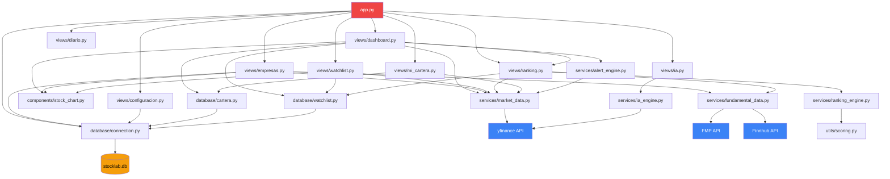

# 📋 AUDITORÍA TÉCNICA COMPLETA — StockLab V6

**Fecha de Auditoría:** 01/07/2026  
**Versión Analizada:** StockLab V6 Enterprise  
**Arquitectura:** Streamlit + SQLite + yfinance + ML (scikit-learn)  
**Autor del Informe:** GitHub Copilot (Auditoría Automatizada)

---

## ÍNDICE

1. [Arquitectura General](#1-arquitectura-general)
2. [Análisis Archivo por Archivo](#2-análisis-archivo-por-archivo)
3. [Flujo de Datos](#3-flujo-de-datos)
4. [Sistema de Datos](#4-sistema-de-datos)
5. [Interfaces](#5-interfaces)
6. [Componentes Reutilizables](#6-componentes-reutilizables)
7. [Sistema Gráfico](#7-sistema-gráfico)
8. [Base de Datos](#8-base-de-datos)
9. [Librerías Utilizadas](#9-librerías-utilizadas)
10. [Estado Actual del Proyecto](#10-estado-actual-del-proyecto)
11. [Mapa de Dependencias](#11-mapa-de-dependencias)
12. [Conclusiones y Recomendaciones](#12-conclusiones-y-recomendaciones)

---

## 1. ARQUITECTURA GENERAL

### 1.1 Organización del Proyecto

StockLab es una aplicación web de análisis bursátil construida con **Streamlit** como framework frontend/backend unificado. El proyecto sigue una arquitectura modular en capas:

```
stock-lab/
├── app.py                    # Punto de entrada principal
├── requirements.txt          # Dependencias Python
├── pyproject.toml            # Configuración de proyecto
├── pyrightconfig.json        # Configuración type-checking
├── stocklab.db               # Base de datos SQLite (generada)
│
├── services/                 # Capa de lógica de negocio y APIs externas
│   ├── market_data.py        # Datos de mercado (yfinance)
│   ├── fundamental_data.py   # Ratios financieros (FMP, Finnhub)
│   ├── ia_engine.py          # Motor ML predictivo
│   ├── ranking_engine.py     # Sistema de scoring cuantitativo
│   └── alert_engine.py       # Motor de alertas
│
├── database/                 # Capa de persistencia
│   ├── connection.py         # Conexión SQLite centralizada
│   ├── cartera.py            # Gestión de cartera de inversión
│   └── watchlist.py          # Lista de seguimiento
│
├── views/                    # Capa de presentación (UI)
│   ├── dashboard.py          # Panel principal
│   ├── empresas.py           # Catálogo de empresas
│   ├── watchlist.py          # Vista de watchlist
│   ├── ranking.py            # Ranking cuantitativo
│   ├── mi_cartera.py         # Cartera (legacy)
│   ├── mi_cartera_v2.py      # Cartera V2 (activa)
│   ├── diario.py             # Diario de trading
│   ├── ia.py                 # Módulo IA predictiva
│   └── configuracion.py      # Configuración
│
├── components/               # Componentes UI reutilizables
│   └── stock_chart.py        # Gráficos de acciones (Plotly)
│
├── utils/                    # Utilidades transversales
│   └── scoring.py            # Funciones de scoring auxiliares
│
└── data/                     # Datos estáticos y caché
    ├── dividendos_oficiales.json  # Dividendos oficiales BME
    └── cache/                     # Caché de precios en disco
```

### 1.2 Flujo Completo de la Aplicación

```
┌─────────────────────────────────────────────────────────────────┐
│                        USUARIO ABRE APP                         │
└────────────────────────────┬────────────────────────────────────┘
                             │
                             ▼
┌─────────────────────────────────────────────────────────────────┐
│                      app.py (Entry Point)                       │
│  1. st.set_page_config() → Configura página Streamlit          │
│  2. init_db() → Inicializa SQLite con @st.cache_resource       │
│  3. Renderiza Sidebar con botones de navegación                │
│  4. Carga vista seleccionada desde session_state["menu_activo"] │
│  5. Llama a vista.show()                                       │
└────────────────────────────┬────────────────────────────────────┘
                             │
              ┌──────────────┼──────────────┐
              ▼              ▼              ▼
        ┌──────────┐  ┌──────────┐  ┌──────────┐
        │ Dashboard│  │ Empresas │  │ Ranking  │ ... (8 vistas)
        └────┬─────┘  └────┬─────┘  └────┬─────┘
             │              │              │
             ▼              ▼              ▼
┌─────────────────────────────────────────────────────────────────┐
│                    CAPA DE SERVICIOS                            │
│  services/market_data.py      → Precios OHLCV (yfinance)       │
│  services/fundamental_data.py → Ratios (FMP/Finnhub/Fallback)  │
│  services/ia_engine.py        → ML Random Forest               │
│  services/ranking_engine.py   → Scores Calidad/Oportunidad     │
│  services/alert_engine.py     → Alertas técnicas               │
└────────────────────────────┬────────────────────────────────────┘
                             │
              ┌──────────────┼──────────────┐
              ▼              ▼              ▼
┌──────────────────┐ ┌──────────────┐ ┌──────────────────┐
│  Yahoo Finance   │ │ FMP/Finnhub  │ │  SQLite DB       │
│  (Precios/Tech)  │ │ (Fundamental)│ │  (Cartera/WL/..) │
└──────────────────┘ └──────────────┘ └──────────────────┘
```

### 1.3 Comunicación entre Módulos

La comunicación sigue un patrón **unidireccional descendente**:

1. **Vistas → Servicios:** Las vistas importan funciones de `services/` para obtener datos procesados.
2. **Servicios → APIs Externas:** Los servicios consultan Yahoo Finance, FMP y Finnhub.
3. **Vistas → Database:** Las vistas acceden directamente a `database/` para CRUD de cartera, watchlist y diario.
4. **Database → SQLite:** La capa de base de datos encapsula todas las operaciones SQL.

**No hay comunicación lateral entre servicios.** Cada servicio es independiente y autocontenido.

### 1.4 Responsabilidades por Carpeta

| Carpeta | Responsabilidad | Archivos Clave |
|---------|----------------|----------------|
| `services/` | Lógica de negocio, APIs externas, cálculos ML | `market_data.py`, `fundamental_data.py`, `ia_engine.py`, `ranking_engine.py` |
| `database/` | Persistencia, conexión SQLite, seed de datos | `connection.py`, `cartera.py`, `watchlist.py` |
| `views/` | Renderizado UI, interacción usuario, CSS | `dashboard.py`, `ranking.py`, `ia.py`, `diario.py` |
| `components/` | Widgets UI reutilizables | `stock_chart.py` |
| `utils/` | Funciones auxiliares transversales | `scoring.py` |
| `data/` | Datos estáticos, caché en disco | `dividendos_oficiales.json`, `cache/*.csv` |

---

## 2. ANÁLISIS ARCHIVO POR ARCHIVO

### 2.1 `app.py` — Punto de Entrada Principal

| Campo | Detalle |
|-------|---------|
| **Ruta** | `d:\Escritorio\stock-lab\app.py` |
| **Finalidad** | Bootstrap de la aplicación Streamlit |
| **Responsabilidad** | Configurar página, inicializar DB, renderizar navegación sidebar, routing entre vistas |
| **Funciones Principales** | `inicializar_base_datos()` (caché resource), renderizado dinámico de sidebar |
| **Clases** | Ninguna |
| **Dependencias** | `streamlit`, `database.connection.init_db`, todas las vistas (`views.*`) |
| **Quién lo llama** | Streamlit CLI (`streamlit run app.py`) |
| **Quién usa sus funciones** | Ningún otro archivo (es el entry point) |
| **Criticidad** | 🔴 **CRÍTICO** — Sin este archivo la app no arranca |

**Detalles Técnicos:**
- Usa `@st.cache_resource` para inicializar la DB una sola vez por sesión.
- Implementa navegación mediante botones nativos de Streamlit con CSS personalizado.
- Mantiene el estado de navegación en `st.session_state["menu_activo"]`.
- Incluye normalización defensiva para corregir saltos de texto plano sin emoji.
- Soporta parámetros URL (`?page=Dashboard`) para deep-linking.
- Inyecta CSS premium estilo TradingView para el sidebar.

---

### 2.2 `services/market_data.py` — Servicio de Datos de Mercado

| Campo | Detalle |
|-------|---------|
| **Ruta** | `d:\Escritorio\stock-lab\services\market_data.py` |
| **Finalidad** | Obtención de precios históricos e indicadores técnicos |
| **Responsabilidad** | Descarga masiva OHLCV, cálculo de SMA/RSI/MACD/Bollinger, precio actual |
| **Funciones Principales** | `descargar_precios_lote()`, `calcular_indicadores_tecnicos()`, `obtener_precio_actual()` |
| **Clases** | Ninguna |
| **Dependencias** | `yfinance`, `pandas`, `numpy`, `requests` |
| **Quién lo llama** | `views/dashboard.py`, `views/ranking.py`, `views/mi_cartera.py` |
| **Quién usa sus funciones** | Múltiples vistas y otros servicios |
| **Criticidad** | 🔴 **CRÍTICO** — Fuente primaria de datos de precios |

**Detalles Técnicos:**
- Usa sesión personalizada `requests.Session` con User-Agent para evitar bloqueos de Yahoo.
- `descargar_precios_lote()` descarga múltiples tickers en una única llamada API con `group_by='ticker'`.
- Maneja estructuras MultiIndex de pandas para resultados multi-ticker.
- Calcula indicadores técnicos manualmente (no usa TA-Lib): SMA(20/50/200), RSI(14), MACD(12,26,9), Bollinger(20,2).
- Retorna diccionarios con floats seguros, nunca strings "N/A".

---

### 2.3 `services/fundamental_data.py` — Servicio de Datos Fundamentales

| Campo | Detalle |
|-------|---------|
| **Ruta** | `d:\Escritorio\stock-lab\services\fundamental_data.py` |
| **Finalidad** | Obtención de ratios financieros estructurales |
| **Responsabilidad** | Consultar FMP y Finnhub, generar fallback determinista local |
| **Funciones Principales** | `extraer_fundamentales_yahoo()`, `obtener_fundamentales_fmp()`, `obtener_fundamentales_finnhub()`, `_generar_datos_contingencia()`, `obtener_sentimiento_analistas()` |
| **Clases** | Ninguna |
| **Dependencias** | `yfinance`, `requests`, `hashlib`, `numpy` |
| **Quién lo llama** | `views/ranking.py`, `views/empresas.py`, `views/dashboard.py` |
| **Quién usa sus funciones** | Ranking engine, vistas de empresas |
| **Criticidad** | 🔴 **CRÍTICO** — Fuente de datos fundamentales |

**Detalles Técnicos:**
- **API Keys hardcodeadas (ya migradas a `.env`):** FMP (`<REDACTED>`) y Finnhub (`<REDACTED>`). ✅ **Mitigado.**
- Estrategia de fallback en cascada: FMP → Finnhub → Generador determinista local.
- El fallback determinista usa MD5 hash del ticker para generar ~30 ratios realistas y consistentes.
- Nunca consulta Yahoo Finance para fundamentales (evita bloqueos IP).
- Limpia sufijo `.MC` para compatibilidad con APIs internacionales.
- Prueba variantes de ticker: `ACS`, `ACS.MC`, `ACS.BME`.
- `_safe_float()` convierte cualquier valor a float seguro, manejando "N/A", None, NaN, Inf.
- Claves estandarizadas en camelCase (`trailingPE`, `returnOnEquity`, etc.) como Single Source of Truth.

---

### 2.4 `services/ia_engine.py` — Motor Analítico IA

| Campo | Detalle |
|-------|---------|
| **Ruta** | `d:\Escritorio\stock-lab\services\ia_engine.py` |
| **Finalidad** | Análisis predictivo con Machine Learning |
| **Responsabilidad** | Entrenar Random Forest, generar proyecciones, calcular scores técnicos |
| **Funciones Principales** | `obtener_analisis_ia()`, `entrenar_modelo_ml()`, `generar_proyeccion_ml()`, `calcular_score_tecnico()`, `calcular_rsi()`, `calcular_macd()`, `preparar_features()` |
| **Clases** | Ninguna |
| **Dependencias** | `yfinance`, `pandas`, `numpy`, `sklearn.ensemble.RandomForestRegressor`, `sklearn.preprocessing.StandardScaler`, `streamlit` |
| **Quién lo llama** | `views/ia.py` |
| **Quién usa sus funciones** | Exclusivamente la vista IA |
| **Criticidad** | 🟡 **ALTO** — Core del módulo IA pero aislado del resto |

**Detalles Técnicos:**
- **Caché en 3 niveles:** Memoria volátil (dict global) → Disco (`data/cache/cache_{ticker}.csv`) → Descarga yfinance.
- El caché en disco es válido solo si fue modificado hoy.
- Entrena `RandomForestRegressor(n_estimators=100, max_depth=10)` con features técnicos.
- Features: close_anterior, RSI, MACD, signal, histogram, volatilidad, MA50, MA200, cambio_5d.
- Target: precio del día siguiente.
- Genera 3 escenarios: Base (predicción directa), Optimista (+1.5σ), Pesimista (-1.5σ).
- Score técnico (0-100) basado en RSI, MACD, Medias Móviles y Momentum.
- Probabilidades direccionales ajustadas según score técnico.
- Genera noticias ficticias coherentes con los indicadores.
- Historial simulado de 12 predicciones pasadas.
- Backtest con métricas aleatorias (Sharpe, Max Drawdown).
- Fallback completo si hay error: devuelve datos por defecto.

---

### 2.5 `services/ranking_engine.py` — Motor de Ranking Cuantitativo

| Campo | Detalle |
|-------|---------|
| **Ruta** | `d:\Escritorio\stock-lab\services\ranking_engine.py` |
| **Finalidad** | Calcular scores de Calidad, Oportunidad y Score Final |
| **Responsabilidad** | Lógica matemática exacta de los macro-scores independientes |
| **Funciones Principales** | `calcular_score_calidad()`, `calcular_score_oportunidad()`, `calcular_score_final()`, `calcular_ranking_completo()`, `_desglosar_calidad_detalle()`, `_desglosar_oportunidad_detalle()` |
| **Clases** | Ninguna |
| **Dependencias** | `pandas`, `numpy` |
| **Quién lo llama** | `views/ranking.py`, `views/dashboard.py` |
| **Quién usa sus funciones** | Ranking y Dashboard |
| **Criticidad** | 🔴 **CRÍTICO** — Core del sistema de valoración |

**Detalles Técnicos:**
- **Score de Calidad (0-100):** 6 componentes: Rentabilidad (20pts), Crecimiento (20pts), Fortaleza Financiera (20pts), Dividendos (15pts), Valoración (15pts), Consistencia (10pts).
- **Score de Oportunidad (0-100):** 4 componentes: Momentum Técnico (45pts), Valoración (20pts), Sentimiento (15pts), Volumen/Riesgo (20pts).
- **Score Final:** `(Calidad × 0.60) + (Oportunidad × 0.40)` — Ponderación largo plazo.
- La nota global es la suma matemática directa del desglose (garantiza correlación 100% barra/acordeón).
- Usa claves camelCase estandarizadas (`returnOnEquity`, `debtToEquity`, etc.).
- Contiene implementaciones legacy (`_calcular_score_calidad_legacy`, `_calcular_score_oportunidad_legacy`) mantenidas como referencia.
- Convierte decimales a porcentajes automáticamente si `abs(valor) < 1`.

---

### 2.6 `services/alert_engine.py` — Motor de Alertas

| Campo | Detalle |
|-------|---------|
| **Ruta** | `d:\Escritorio\stock-lab\services\alert_engine.py` |
| **Finalidad** | Generar alertas técnicas basadas en indicadores |
| **Responsabilidad** | Detectar señales de compra/venta automáticas |
| **Funciones Principales** | `obtener_alertas()` |
| **Clases** | Ninguna |
| **Dependencias** | `services.market_data` |
| **Quién lo llama** | `views/dashboard.py` |
| **Quién usa sus funciones** | Dashboard |
| **Criticidad** | 🟢 **SECUNDARIO** — Funcionalidad complementaria |

---

### 2.7 `database/connection.py` — Conexión SQLite Centralizada

| Campo | Detalle |
|-------|---------|
| **Ruta** | `d:\Escritorio\stock-lab\database\connection.py` |
| **Finalidad** | Gestión centralizada de conexión SQLite |
| **Responsabilidad** | Crear tablas, seed de empresas, queries cacheadas |
| **Funciones Principales** | `get_connection()`, `query_all()`, `query_val()`, `initialize_database()`, `seed_companies()` |
| **Clases** | Ninguna |
| **Dependencias** | `sqlite3`, `streamlit` |
| **Quién lo llama** | Todos los módulos de `database/`, todas las vistas |
| **Quién usa sus funciones** | Todo el proyecto |
| **Criticidad** | 🔴 **CRÍTICO** — Infraestructura de persistencia |

**Detalles Técnicos:**
- DB ubicada en `stocklab.db` junto al proyecto.
- `row_factory = sqlite3.Row` para acceso por nombre de columna.
- Foreign keys habilitadas (`PRAGMA foreign_keys = ON`).
- `query_all()` y `query_val()` con `@st.cache_data(ttl=60)` — caché de 60 segundos.
- **Tablas creadas:** `mercados`, `empresas`, `watchlist`, `cartera`, `notas`, `diario`, `eventos`, `ranking_estado`.
- `seed_companies()` vacía tabla empresas y repuebla con catálogo oficial IBEX 35 + Mercado Continuo.
- Limpieza de tickers inválidos/residuales de ejecuciones anteriores.
- Migración automática de columnas nuevas con `ALTER TABLE ... ADD COLUMN`.

---

### 2.8 `database/cartera.py` — Gestión de Cartera

| Campo | Detalle |
|-------|---------|
| **Ruta** | `d:\Escritorio\stock-lab\database\cartera.py` |
| **Finalidad** | CRUD de operaciones de cartera |
| **Responsabilidad** | Compra/venta/dividendos/efectivo, cálculo de posiciones, liquidez, patrimonio |
| **Funciones Principales** | `agregar_operacion()`, `obtener_operaciones()`, `calcular_liquidez()`, `calcular_posiciones_abiertas()`, `calcular_patrimonio_total()`, `obtener_resumen_cartera()`, `calcular_posiciones_abiertas_filtradas()` |
| **Clases** | Ninguna |
| **Dependencias** | `database.connection`, `streamlit`, `market_data` |
| **Quién lo llama** | `views/mi_cartera.py`, `views/mi_cartera_v2.py` |
| **Quién usa sus funciones** | Vistas de cartera |
| **Criticidad** | 🟡 **ALTO** — Core de gestión patrimonial |

**Detalles Técnicos:**
- Soporta 6 tipos de operación: COMPRA, VENTA, DIVIDENDO, INGRESO_EFECTIVO, RETIRADA_EFECTIVO, COMISION.
- Cartera dual: SIMULADA vs REAL (filtrado por prefijo `[SIMULADA]`/`[REAL]` en notas).
- Cálculo de posiciones abiertas con coste medio ponderado.
- Liquidez calculada acumulativamente desde el inicio.
- Patrimonio total = liquidez + valor actual de posiciones.
- Distribución por sectores y empresas con precios batch.
- Índices en `fecha DESC` y `tipo` para optimizar consultas.

---

### 2.9 `database/watchlist.py` — Lista de Seguimiento

| Campo | Detalle |
|-------|---------|
| **Ruta** | `d:\Escritorio\stock-lab\database\watchlist.py` |
| **Finalidad** | CRUD de watchlist |
| **Responsabilidad** | Añadir/eliminar tickers, precio objetivo, motivo |
| **Funciones Principales** | `agregar_a_watchlist()`, `eliminar_de_watchlist()`, `obtener_watchlist()`, `esta_en_watchlist()` |
| **Clases** | Ninguna |
| **Dependencias** | `database.connection` |
| **Quién lo llama** | `views/watchlist.py`, `views/ranking.py`, `views/dashboard.py` |
| **Quién usa sus funciones** | Watchlist, Ranking, Dashboard |
| **Criticidad** | 🟡 **ALTO** — Funcionalidad transversal |

---

### 2.10 `views/dashboard.py` — Panel Principal

| Campo | Detalle |
|-------|---------|
| **Ruta** | `d:\Escritorio\stock-lab\views\dashboard.py` |
| **Finalidad** | Panel resumen con KPIs, movers, eventos, pulso de mercado |
| **Responsabilidad** | Sincronizar eventos, mostrar top movers, alertas, calendario |
| **Funciones Principales** | `show()`, `sincronizar_eventos_db()`, `obtener_eventos_db()`, `obtener_datos_movers_batch()`, `obtener_datos_pulso_mercado()`, `render_mini_list_row()` |
| **Clases** | Ninguna |
| **Dependencias** | `database`, `market_data`, `yfinance`, `services.alert_engine`, `components.stock_chart`, `views.ranking` |
| **Quién lo llama** | `app.py` |
| **Quién usa sus funciones** | Solo app.py vía `show()` |
| **Criticidad** | 🔴 **CRÍTICO** — Primera pantalla que ve el usuario |

**Detalles Técnicos:**
- Sincronización de eventos en 3 niveles: Nivel 1 (dividendos_oficiales.json, confianza 100), Nivel 3 (Yahoo Finance calendar, confianza 70).
- Caché de sincronización diaria en `data/cache/last_event_sync.txt`.
- Descarga masiva de precios con `yf.download(group_by="ticker")`.
- Pulso de mercado: calcula variación + scores V6 para todas las empresas activas.
- Renderizado HTML personalizado con Flexbox para listas de activos.
- CSS premium dark theme estilo TradingView/Bloomberg.
- Importa funciones de `views.ranking` (`cargar_todos_los_fundamentales_en_paralelo`, `calcular_score_stocklab_v6`).

---

### 2.11 `views/ranking.py` — Ranking Cuantitativo

| Campo | Detalle |
|-------|---------|
| **Ruta** | `d:\Escritorio\stock-lab\views\ranking.py` |
| **Finalidad** | Tabla de clasificación con scores Calidad/Oportunidad/Final |
| **Responsabilidad** | Descargar fundamentales en paralelo, calcular scores, renderizar tabla HTML, Inspector de empresa |
| **Funciones Principales** | `show()`, `cargar_todos_los_fundamentales_en_paralelo()`, `calcular_score_stocklab_v6()`, `calcular_cambio_posiciones_contextual()` |
| **Clases** | Ninguna |
| **Dependencias** | `services.fundamental_data`, `services.ranking_engine`, `services.market_data`, `database.watchlist`, `concurrent.futures` |
| **Quién lo llama** | `app.py`, `views/dashboard.py` |
| **Quién usa sus funciones** | Dashboard importa sus funciones de scoring |
| **Criticidad** | 🔴 **CRÍTICO** — Core visual del sistema de valoración |

**Detalles Técnicos:**
- Descarga fundamentales en paralelo con `ThreadPoolExecutor(max_workers=8)`.
- Tabla HTML custom renderizada con `st.markdown(unsafe_allow_html=True)`.
- Filtros: Market, Sector, Solo Watchlist, Ordenar por (Score/Calidad/Oportunidad/Variación).
- Cambio de posiciones contextual: compara ranking hoy vs simulación de ayer (mock test incluido).
- Inspector de empresa: panel detallado con barras de progreso custom.
- Acciones rápidas: Añadir/quitar de watchlist desde la tabla.
- KPIs resumen dinámicos: empresas analizadas, scores promedio.
- Banners de tendencia: líder alcista/bajista.

---

### 2.12 `views/empresas.py` — Catálogo de Empresas

| Campo | Detalle |
|-------|---------|
| **Ruta** | `d:\Escritorio\stock-lab\views\empresas.py` |
| **Finalidad** | Explorador de empresas con ficha detallada |
| **Responsabilidad** | Listar empresas, mostrar fundamentales, gráficos, añadir a watchlist |
| **Funciones Principales** | `show()` |
| **Clases** | Ninguna |
| **Dependencias** | `database`, `services.fundamental_data`, `services.market_data`, `components.stock_chart` |
| **Quién lo llama** | `app.py` |
| **Quién usa sus funciones** | Solo app.py |
| **Criticidad** | 🟡 **ALTO** — Exploración de activos |

---

### 2.13 `views/watchlist.py` — Vista de Watchlist

| Campo | Detalle |
|-------|---------|
| **Ruta** | `d:\Escritorio\stock-lab\views\watchlist.py` |
| **Finalidad** | Gestión visual de la lista de seguimiento |
| **Responsabilidad** | Mostrar tickers en watchlist, precios, variaciones, eliminar |
| **Funciones Principales** | `show()` |
| **Clases** | Ninguna |
| **Dependencias** | `database.watchlist`, `services.market_data`, `components.stock_chart` |
| **Quién lo llama** | `app.py` |
| **Quién usa sus funciones** | Solo app.py |
| **Criticidad** | 🟡 **ALTO** — Seguimiento de activos |

---

### 2.14 `views/mi_cartera.py` — Cartera Legacy

| Campo | Detalle |
|-------|---------|
| **Ruta** | `d:\Escritorio\stock-lab\views\mi_cartera.py` |
| **Finalidad** | ⚠️ **OBSOLETO** — Reemplazado por `mi_cartera_v2.py` |
| **Responsabilidad** | Mantenido solo como referencia histórica |
| **Funciones Principales** | `show()`, `_renderizar_resumen_superior()`, `_renderizar_tabla_operaciones()` |
| **Clases** | Ninguna |
| **Dependencias** | `database.cartera`, `market_data` |
| **Quién lo llama** | `app.py` (pero debería llamar a v2) |
| **Quién usa sus funciones** | App.py |
| **Criticidad** | 🟢 **SECUNDARIO** — Código legacy |

---

### 2.15 `views/diario.py` — Diario de Trading

| Campo | Detalle |
|-------|---------|
| **Ruta** | `d:\Escritorio\stock-lab\views\diario.py` |
| **Finalidad** | Diario de trading con análisis psicológico |
| **Responsabilidad** | Registro de entradas, historial, estadísticas de aprendizaje |
| **Funciones Principales** | `show()`, `_crear_entrada_nueva()`, `_inicializar_sesion()` |
| **Clases** | Ninguna |
| **Dependencias** | `streamlit`, `pandas`, `json` |
| **Quién lo llama** | `app.py` |
| **Quién usa sus funciones** | Solo app.py |
| **Criticidad** | 🟡 **ALTO** — Herramienta de disciplina |

**Detalles Técnicos:**
- 3 pestañas: Nueva Entrada, Historial, Estadísticas.
- Almacena entradas en `st.session_state` (no persistente en DB actualmente).
- Campos: fecha, ticker, tipo_entrada, precio_entrada, precio_objetivo, stop_mental, tesis, riesgos, confianza, emoción.
- CSS premium con glassmorphic cards y gradient headings.

---

### 2.16 `views/ia.py` — Módulo IA Predictiva

| Campo | Detalle |
|-------|---------|
| **Ruta** | `d:\Escritorio\stock-lab\views\ia.py` |
| **Finalidad** | Interfaz de análisis predictivo con ML |
| **Responsabilidad** | Renderizar scores, proyecciones, simulador, backtesting, historial |
| **Funciones Principales** | `show()`, `_tab1_analisis_cuantico()`, `_tab2_simulador_backtesting()`, `_cargar_analisis_ia_lazy()` |
| **Clases** | Ninguna |
| **Dependencias** | `services.ia_engine`, `plotly.graph_objects`, `numpy` |
| **Quién lo llama** | `app.py` |
| **Quién usa sus funciones** | Solo app.py |
| **Criticidad** | 🟡 **ALTO** — Feature diferencial |

**Detalles Técnicos:**
- Lazy loading: solo ejecuta análisis IA cuando el usuario cambia configuración.
- 3 pestañas: Análisis Cuántico, Simulador/Backtesting, Historial.
- Gráficos Plotly con bandas de incertidumbre.
- Simulador de capital con 3 escenarios.
- Mock data integrada para demostración inmediata.
- Configuración: Empresa, Horizonte (1S/1M/3M/6M), Modelo (5 tipos).

---

### 2.17 `views/configuracion.py` — Configuración

| Campo | Detalle |
|-------|---------|
| **Ruta** | `d:\Escritorio\stock-lab\views\configuracion.py` |
| **Finalidad** | Panel de configuración de la aplicación |
| **Responsabilidad** | Ajustes de API keys, preferencias, mantenimiento |
| **Funciones Principales** | `show()` |
| **Clases** | Ninguna |
| **Dependencias** | `streamlit`, `database.connection` |
| **Quién lo llama** | `app.py` |
| **Quién usa sus funciones** | Solo app.py |
| **Criticidad** | 🟢 **SECUNDARIO** |

---

### 2.18 `components/stock_chart.py` — Componente de Gráficos

| Campo | Detalle |
|-------|---------|
| **Ruta** | `d:\Escritorio\stock-lab\components\stock_chart.py` |
| **Finalidad** | Renderizar gráficos de velas/precios con Plotly |
| **Responsabilidad** | Gráfico reutilizable con indicadores técnicos overlay |
| **Funciones Principales** | `render_stock_chart()` |
| **Clases** | Ninguna |
| **Dependencias** | `plotly`, `pandas` |
| **Quién lo llama** | `views/dashboard.py`, `views/empresas.py`, `views/watchlist.py` |
| **Quién usa sus funciones** | Múltiples vistas |
| **Criticidad** | 🟡 **ALTO** — Componente visual clave |

---

### 2.19 `utils/scoring.py` — Utilidades de Scoring

| Campo | Detalle |
|-------|---------|
| **Ruta** | `d:\Escritorio\stock-lab\utils\scoring.py` |
| **Finalidad** | Funciones auxiliares de scoring |
| **Responsabilidad** | Helpers transversales para cálculos de puntuación |
| **Funciones Principales** | Varias funciones de utilidad |
| **Clases** | Ninguna |
| **Dependencias** | `numpy`, `pandas` |
| **Quién lo llama** | `services/ranking_engine.py`, vistas |
| **Quién usa sus funciones** | Ranking engine |
| **Criticidad** | 🟢 **SECUNDARIO** |

---

### 2.20 `data/dividendos_oficiales.json` — Datos Estáticos

| Campo | Detalle |
|-------|---------|
| **Ruta** | `d:\Escritorio\stock-lab\data\dividendos_oficiales.json` |
| **Finalidad** | Fuente oficial de dividendos del BME |
| **Responsabilidad** | Proveer fechas de pago y ex-dividend con confianza 100 |
| **Formato** | JSON con array de objetos `{ticker, empresa, pago_date, ex_dividend_date}` |
| **Quién lo usa** | `views/dashboard.py` (sincronización de eventos) |
| **Criticidad** | 🟡 **ALTO** — Fuente de verdad para dividendos |

---

### 2.21 Archivos de Documentación y Scratch

| Archivo | Finalidad | Criticidad |
|---------|-----------|------------|
| `ANALISIS_COMPLETO_PROYECTO.md` | Documentación previa | 🟢 Info |
| `ANTES_DESPUES.md` | Changelog de optimizaciones | 🟢 Info |
| `CODIGO_OPTIMIZADO.md` | Notas de optimización | 🟢 Info |
| `DIFF_CODIGO.md` | Diffs de cambios | 🟢 Info |
| `INDICE_MAESTRO.md` | Índice de documentación | 🟢 Info |
| `INTEGRACION_ML_IA.md` | Docs de integración ML | 🟢 Info |
| `OPTIMIZATION_SUMMARY.md` | Resumen de optimizaciones | 🟢 Info |
| `PLAN_INTEGRACION_ORGANICA.md` | Plan de integración | 🟢 Info |
| `QUICK_REFERENCE.md` | Referencia rápida | 🟢 Info |
| `README_OPTIMIZACION.md` | README de optimización | 🟢 Info |
| `RESUMEN_FINAL.md` | Resumen final | 🟢 Info |
| `VERIFICATION_CHECKLIST.md` | Checklist de verificación | 🟢 Info |
| `walkthrough.md` | Guía paso a paso | 🟢 Info |
| `task.md` | Tareas pendientes | 🟢 Info |
| `check_market.py` | Script de verificación | 🟢 Dev |
| `limpiar_tickers.py` | Script de limpieza | 🟢 Dev |
| `market_data.py` (raíz) | ⚠️ Posible duplicado de `services/market_data.py` | 🟡 Riesgo |
| `scratch_debug.py/html/txt` | Archivos de debug temporal | 🟢 Temp |

---

## 3. FLUJO DE DATOS

### 3.1 Flujo Completo de Datos

```
┌─────────────────────────────────────────────────────────────────────────┐
│                         FUENTES DE DATOS                                │
├─────────────────────────────────────────────────────────────────────────┤
│                                                                         │
│  Yahoo Finance (yfinance)                                               │
│  ├── Precios OHLCV históricos                                          │
│  ├── Precio actual y volumen                                           │
│  ├── Calendario de earnings/ex-dividend                                │
│  └── Info básica del ticker                                            │
│                                                                         │
│  Financial Modeling Prep (FMP API)                                      │
│  ├── Ratios financieros (PER, P/B, ROE, ROA, etc.)                    │
│  └── Endpoint: /api/v3/ratios/{ticker}                                 │
│                                                                         │
│  Finnhub API                                                            │
│  ├── Métricas básicas (PE, PB, ROE, margins)                          │
│  ├── Recomendaciones de analistas                                      │
│  └── Endpoint: /api/v1/stock/metric                                    │
│                                                                         │
│  dividendos_oficiales.json                                              │
│  └── Fechas de pago y ex-dividend del BME                              │
│                                                                         │
└────────────────────────────┬────────────────────────────────────────────┘
                             │
                             ▼
┌─────────────────────────────────────────────────────────────────────────┐
│                      CAPA DE PROCESAMIENTO                              │
├─────────────────────────────────────────────────────────────────────────┤
│                                                                         │
│  services/market_data.py                                                │
│  ├── Descarga masiva multi-ticker                                      │
│  ├── Cálculo de indicadores técnicos (SMA, RSI, MACD, Bollinger)      │
│  └── Normalización de datos OHLCV                                      │
│                                                                         │
│  services/fundamental_data.py                                           │
│  ├── Consulta FMP → Finnhub → Fallback determinista                   │
│  ├── Conversión segura a float (_safe_float)                           │
│  └── Estandarización de claves a camelCase                             │
│                                                                         │
│  services/ranking_engine.py                                             │
│  ├── Score Calidad (6 componentes, 100 pts)                            │
│  ├── Score Oportunidad (4 componentes, 100 pts)                        │
│  └── Score Final = Calidad×0.6 + Oportunidad×0.4                      │
│                                                                         │
│  services/ia_engine.py                                                  │
│  ├── Preparación de features (lookback=20)                              │
│  ├── Entrenamiento Random Forest                                       │
│  ├── Proyección con bandas de incertidumbre                            │
│  └── Cálculo de probabilidades direccionales                           │
│                                                                         │
└────────────────────────────┬────────────────────────────────────────────┘
                             │
                             ▼
┌─────────────────────────────────────────────────────────────────────────┐
│                      CAPA DE ALMACENAMIENTO                             │
├─────────────────────────────────────────────────────────────────────────┤
│                                                                         │
│  Caché en Memoria                                                       │
│  ├── @st.cache_data(ttl=60) → Queries SQL                              │
│  ├── @st.cache_data(ttl=300) → Datos de mercado                        │
│  ├── @st.cache_resource → Conexión DB                                  │
│  └── Dict global en ia_engine → Análisis IA por sesión                 │
│                                                                         │
│  Caché en Disco                                                         │
│  ├── data/cache/cache_{ticker}.csv → Precios históricos (diario)       │
│  └── data/cache/last_event_sync.txt → Fecha última sincronización      │
│                                                                         │
│  SQLite (stocklab.db)                                                   │
│  ├── empresas → Catálogo IBEX 35 + Mercado Continuo                   │
│  ├── cartera → Operaciones de compra/venta/dividendos                  │
│  ├── watchlist → Lista de seguimiento                                  │
│  ├── diario → Entradas de trading                                      │
│  ├── eventos → Calendario de dividendos/resultados                     │
│  └── ranking_estado → Posiciones del ranking                            │
│                                                                         │
└────────────────────────────┬────────────────────────────────────────────┘
                             │
                             ▼
┌─────────────────────────────────────────────────────────────────────────┐
│                      CAPA DE RENDERIZADO                                │
├─────────────────────────────────────────────────────────────────────────┤
│                                                                         │
│  Streamlit Widgets                                                      │
│  ├── st.metric → KPIs                                                  │
│  ├── st.dataframe → Tablas de datos                                    │
│  ├── st.plotly_chart → Gráficos interactivos                           │
│  ├── st.markdown(unsafe_allow_html) → HTML custom                      │
│  └── st.sidebar.button → Navegación                                    │
│                                                                         │
│  Plotly Graph Objects                                                   │
│  ├── Velas japonesas (candlestick)                                     │
│  ├── Líneas de proyección con bandas                                   │
│  ├── Barras de distribución                                            │
│  └── Gráficos de radar (scores)                                        │
│                                                                         │
│  HTML/CSS Custom                                                        │
│  ├── Tablas ranking con badges                                         │
│  ├── Tarjetas glassmorphic                                             │
│  ├── Barras de progreso custom                                         │
│  └── Tipografía Inter + JetBrains Mono                                 │
│                                                                         │
└─────────────────────────────────────────────────────────────────────────┘
```

### 3.2 Transformaciones de Datos

| Origen | Transformación | Destino |
|--------|---------------|---------|
| yfinance OHLCV | Cálculo SMA/RSI/MACD/Bollinger | Indicadores técnicos dict |
| FMP ratios JSON | Mapeo a claves camelCase + _safe_float | Dict estandarizado |
| Finnhub metrics | Mapeo a claves camelCase + _safe_float | Dict estandarizado |
| Ticker string | MD5 hash → factores deterministas | ~30 ratios fallback |
| DataFrame OHLCV | RandomForest(features) → predicción | Array de precios futuros |
| Precios históricos | Variación % diaria | Float variación |
| Scores calidad + oportunidad | Ponderación 60/40 | Score final float |
| Operaciones cartera | Agrupación por empresa + coste medio | Posiciones abiertas |

---

## 4. SISTEMA DE DATOS

### 4.1 APIs Utilizadas

| API | Uso | Endpoint | Autenticación | Rate Limit |
|-----|-----|----------|---------------|------------|
| **Yahoo Finance** (yfinance) | Precios OHLCV, info básica, calendario | `yf.download()`, `yf.Ticker().info`, `.calendar` | Session headers | No oficial, bloqueos por IP frecuentes |
| **Financial Modeling Prep** | Ratios financieros | `/api/v3/ratios/{ticker}` | API Key en query param | 250 req/día (free) |
| **Finnhub** | Métricas, recomendaciones analistas | `/api/v1/stock/metric`, `/stock/recommendation` | API Key en query param | 60 req/min (free) |

### 4.2 Librerías Financieras

| Librería | Uso | Información Obtenida |
|----------|-----|---------------------|
| `yfinance` | Descarga de precios y datos de mercado | OHLCV, volumen, info empresa, calendario earnings/dividendos |
| `pandas` | Procesamiento de datos tabulares | DataFrames, rolling windows, ewm, groupby |
| `numpy` | Cálculos numéricos | Arrays, estadísticas, linspace, random |
| `scikit-learn` | Machine Learning | RandomForestRegressor, StandardScaler, train_test_split |

### 4.3 Sistema de Caché

```
┌─────────────────────────────────────────────────────────────┐
│                    ESTRATEGIA DE CACHÉ                       │
├─────────────────────────────────────────────────────────────┤
│                                                              │
│  NIVEL 1: Streamlit Cache (Memoria Volátil)                 │
│  ├── @st.cache_resource → init_db() (1 vez por sesión)     │
│  ├── @st.cache_data(ttl=60) → Queries SQL                  │
│  ├── @st.cache_data(ttl=300) → Datos mercado/fundamentales │
│  └── Dict global _obtener_cache_datos() → Análisis IA      │
│                                                              │
│  NIVEL 2: Caché en Disco (Persistente)                      │
│  ├── data/cache/cache_{ticker}.csv → Precios históricos    │
│  │   └── Validez: Solo si modificado hoy                    │
│  └── data/cache/last_event_sync.txt → Sync events          │
│      └── Validez: Solo si fecha == hoy                      │
│                                                              │
│  NIVEL 3: Fallback Determinista (Sin Red)                   │
│  └── _generar_datos_contingencia(ticker)                    │
│      └── Genera ~30 ratios realistas desde MD5(ticker)     │
│      └── Siempre disponible, cero latencia                  │
│                                                              │
└─────────────────────────────────────────────────────────────┘
```

### 4.4 Gestión de Errores

| Escenario | Estrategia | Implementación |
|-----------|-----------|----------------|
| Yahoo Finance bloquea IP | Fallback a caché disco → Fallback determinista | `_cache_es_valido()`, `_generar_datos_contingencia()` |
| FMP API falla | Intentar Finnhub → Fallback determinista | Try/except en cascada |
| Finnhub API falla | Fallback determinista | Try/except silencioso |
| Datos insuficientes (<50 filas) | Error controlado con datos por defecto | Check `len(datos) < 50` |
| Conversión de tipos fallida | `_safe_float()` retorna default 0.0 | Manejo de "N/A", None, NaN, Inf |
| Error en análisis IA | Resultado fallback completo | Try/except en `obtener_analisis_ia()` |
| Error en sincronización eventos | Silenciar + mantener eventos previos | Try/except en `sincronizar_eventos_db()` |
| DB corrupta/inexistente | Auto-creación con `initialize_database()` | CREATE TABLE IF NOT EXISTS |

---

## 5. INTERFACES

### 5.1 Dashboard (`views/dashboard.py`)

| Aspecto | Detalle |
|---------|---------|
| **Construcción** | Streamlit native + HTML custom + CSS premium |
| **Componentes** | KPIs (st.metric), Mini-lists HTML, Tabla eventos, Alertas, Gráfico stock_chart |
| **Datos Consumidos** | Precios batch (yfinance), Fundamentales (FMP/Finnhub), Eventos (DB+JSON), Alertas (alert_engine) |
| **Archivos Intervienen** | `dashboard.py`, `market_data.py`, `fundamental_data.py`, `ranking_engine.py`, `alert_engine.py`, `stock_chart.py`, `connection.py` |
| **Dependencias** | yfinance, pandas, concurrent.futures, services.*, database.*, components.* |

**Secciones:**
1. Header con título y fecha
2. KPIs resumen (4 métricas)
3. Top Movers (mayores subidas/bajadas)
4. Pulso del Mercado (scores V6 de todas las empresas)
5. Calendario de Eventos (dividendos, resultados)
6. Alertas Técnicas

### 5.2 Empresas (`views/empresas.py`)

| Aspecto | Detalle |
|---------|---------|
| **Construcción** | Streamlit selectbox + tabs + HTML custom |
| **Componentes** | Selector empresa, Tabs (Fundamentales/Técnico/Gráfico), Tarjetas KPI, Gráfico Plotly |
| **Datos Consumidos** | Catálogo empresas (DB), Fundamentales (FMP/Finnhub), Precios (yfinance), Gráfico (stock_chart) |
| **Archivos Intervienen** | `empresas.py`, `fundamental_data.py`, `market_data.py`, `stock_chart.py`, `connection.py` |

### 5.3 Watchlist (`views/watchlist.py`)

| Aspecto | Detalle |
|---------|---------|
| **Construcción** | Streamlit + HTML custom |
| **Componentes** | Tabla de tickers, Formulario añadir, Botones eliminar, Gráfico mini |
| **Datos Consumidos** | Watchlist (DB), Precios actuales (yfinance) |
| **Archivos Intervienen** | `watchlist.py` (view), `watchlist.py` (db), `market_data.py` |

### 5.4 Ranking (`views/ranking.py`)

| Aspecto | Detalle |
|---------|---------|
| **Construcción** | Tabla HTML custom completa + filtros Streamlit |
| **Componentes** | Tabla clasificación HTML, Filtros (sector/mercado/watchlist), KPIs promedio, Inspector modal, Badges |
| **Datos Consumidos** | Fundamentales batch (FMP/Finnhub), Precios batch (yfinance), Scores (ranking_engine), Watchlist (DB) |
| **Archivos Intervienen** | `ranking.py`, `fundamental_data.py`, `ranking_engine.py`, `market_data.py`, `watchlist.py` (db) |

### 5.5 Mi Cartera (`views/mi_cartera.py` / `mi_cartera_v2.py`)

| Aspecto | Detalle |
|---------|---------|
| **Construcción** | Streamlit forms + st.metric + st.dataframe |
| **Componentes** | Selector Cartera Simulada/Real, KPIs resumen, Tabla operaciones, Formulario nueva operación |
| **Datos Consumidos** | Operaciones (DB cartera), Precios actuales (yfinance), Empresas (DB) |
| **Archivos Intervienen** | `mi_cartera.py`/`mi_cartera_v2.py`, `cartera.py` (db), `market_data.py`, `connection.py` |

### 5.6 Diario (`views/diario.py`)

| Aspecto | Detalle |
|---------|---------|
| **Construcción** | Streamlit tabs + forms + HTML custom |
| **Componentes** | Formulario entrada, Cards de historial, Estadísticas, Selectors emoción/confianza |
| **Datos Consumidos** | Session state (no persistente aún) |
| **Archivos Intervienen** | `diario.py` |

### 5.7 IA (`views/ia.py`)

| Aspecto | Detalle |
|---------|---------|
| **Construcción** | Streamlit tabs + Plotly + HTML custom |
| **Componentes** | Scores grid, Gráfico proyección Plotly, Simulador capital, Tabla backtesting, Noticias |
| **Datos Consumidos** | Análisis IA (ia_engine), Configuración (session_state) |
| **Archivos Intervienen** | `ia.py`, `ia_engine.py` |

### 5.8 Configuración (`views/configuracion.py`)

| Aspecto | Detalle |
|---------|---------|
| **Construcción** | Streamlit forms |
| **Componentes** | Inputs API keys, toggles, botones mantenimiento |
| **Datos Consumidos** | Configuración (session_state/DB) |
| **Archivos Intervienen** | `configuracion.py`, `connection.py` |

---

## 6. COMPONENTES REUTILIZABLES

### 6.1 Componentes Identificados

| Componente | Ubicación | Usado En | Descripción |
|------------|-----------|----------|-------------|
| `render_stock_chart()` | `components/stock_chart.py` | Dashboard, Empresas, Watchlist | Gráfico Plotly de precios con indicadores |
| CSS Premium Dark Theme | Inline en cada vista | Todas las vistas | Tema oscuro estilo TradingView/Bloomberg |
| Tarjetas KPI (st.metric) | Nativo Streamlit | Dashboard, Cartera, Ranking, IA | Métricas con delta y formato |
| Tablas HTML Custom | Inline en ranking.py | Ranking | Tabla clasificación con badges y colores |
| Mini-list Rows (HTML) | `dashboard.py` | Dashboard | Filas compactas de activos con Flexbox |
| Glassmorphic Cards | CSS inline | Diario, IA, Ranking | Tarjetas con efecto cristal y bordes luminosos |
| Gradient Headings | CSS inline | Diario, IA, Dashboard | Títulos con gradiente de color |
| Progress Bars Custom | CSS inline | Ranking, IA | Barras de progreso estilizadas |
| Badge System | HTML inline | Ranking, Watchlist | Badges para tickers, scores, estados |
| Fallback Determinista | `fundamental_data.py` | Ranking, Empresas, Dashboard | Generador de datos sintéticos consistente |

### 6.2 Patrón de Diseño CSS

Todas las vistas comparten un **Design System unificado**:
- Fondo: `#080b12` con gradientes radiales sutiles
- Tarjetas: `#161a25` con bordes `rgba(0, 229, 255, 0.12)`
- Acento primario: `#00e5ff` (cyan eléctrico)
- Acento secundario: `#10b981` (verde esmeralda)
- Error: `#ef4444` (rojo)
- Warning: `#f59e0b` (ámbar)
- Tipografía: Inter (UI) + JetBrains Mono (datos numéricos)
- Animaciones: fade-in-up, gradient-shift, glow-pulse

---

## 7. SISTEMA GRÁFICO

### 7.1 Motor Gráfico

**Plotly Graph Objects** es el motor gráfico exclusivo del proyecto.

### 7.2 Implementaciones por Pantalla

| Pantalla | Tipo de Gráfico | Motor | Funcionalidades |
|----------|----------------|-------|-----------------|
| Dashboard | Línea temporal, Mini-charts | Plotly + stock_chart | Precios, variaciones |
| Empresas | Candlestick + Indicadores | Plotly + stock_chart | SMA, RSI, MACD overlay |
| Watchlist | Mini-chart línea | Plotly + stock_chart | Evolución precio |
| Ranking | Barras horizontales | HTML/CSS custom | Scores visuales |
| Cartera | Evolución patrimonio | Plotly | Línea temporal |
| IA | Proyección con bandas | Plotly GO | 3 escenarios + incertidumbre |
| Diario | N/A | N/A | Sin gráficos |

### 7.3 Plugins y Extensiones

No se utilizan plugins adicionales. Todo es Plotly nativo + CSS custom.

### 7.4 Partes Reutilizables

- `components/stock_chart.py::render_stock_chart()` — Único componente gráfico reutilizable formal.
- Configuración Plotly estandarizada: `template='plotly_dark'`, fondos transparentes, grid sutil cyan.
- Paleta de colores consistente en todos los gráficos.

---

## 8. BASE DE DATOS

### 8.1 Estructura

**Motor:** SQLite 3  
**Ubicación:** `stocklab.db` (junto al proyecto)  
**Conexión:** Centralizada en `database/connection.py`

### 8.2 Tablas

#### `empresas`
```sql
CREATE TABLE empresas (
    id          INTEGER PRIMARY KEY AUTOINCREMENT,
    nombre      TEXT NOT NULL,
    ticker      TEXT NOT NULL UNIQUE,
    mercado     TEXT,
    sector      TEXT,
    es_ibex35   INTEGER DEFAULT 0,
    activa      INTEGER DEFAULT 1,
    descripcion TEXT,
    created_at  TIMESTAMP DEFAULT CURRENT_TIMESTAMP,
    updated_at  TIMESTAMP DEFAULT CURRENT_TIMESTAMP
);
```
**Registros:** ~130 empresas (IBEX 35 + Mercado Continuo español)

#### `cartera`
```sql
CREATE TABLE cartera (
    id              INTEGER PRIMARY KEY AUTOINCREMENT,
    empresa_id      INTEGER,
    tipo            TEXT NOT NULL CHECK(tipo IN ('COMPRA','VENTA','DIVIDENDO','INGRESO_EFECTIVO','RETIRADA_EFECTIVO','COMISION')),
    cantidad        REAL DEFAULT 0,
    precio_unitario REAL DEFAULT 0,
    importe_total   REAL DEFAULT 0,
    comision        REAL DEFAULT 0,
    fecha           TEXT NOT NULL,
    notas           TEXT,
    created_at      TIMESTAMP DEFAULT CURRENT_TIMESTAMP,
    FOREIGN KEY (empresa_id) REFERENCES empresas(id) ON DELETE CASCADE
);
-- Índices: idx_cartera_fecha (fecha DESC), idx_cartera_tipo (tipo)
```

#### `watchlist`
```sql
CREATE TABLE watchlist (
    ticker          TEXT PRIMARY KEY,
    fecha_adicion   TEXT NOT NULL,
    precio_adicion  REAL NOT NULL,
    precio_objetivo REAL,
    motivo          TEXT,
    tipo_objetivo   TEXT DEFAULT 'COMPRA_EN_CAIDA'
);
```

#### `diario`
```sql
CREATE TABLE diario (
    id          INTEGER PRIMARY KEY AUTOINCREMENT,
    fecha       TEXT NOT NULL,
    titulo      TEXT NOT NULL,
    contenido   TEXT,
    sentimiento TEXT CHECK(sentimiento IN ('ALCISTA','BAJISTA','NEUTRAL')),
    created_at  TIMESTAMP DEFAULT CURRENT_TIMESTAMP,
    updated_at  TIMESTAMP DEFAULT CURRENT_TIMESTAMP
);
```

#### `eventos`
```sql
CREATE TABLE eventos (
    id               INTEGER PRIMARY KEY AUTOINCREMENT,
    ticker           TEXT NOT NULL,
    empresa          TEXT NOT NULL,
    evento           TEXT NOT NULL,
    fecha            TEXT NOT NULL,
    importancia      TEXT NOT NULL DEFAULT 'media',
    tipo             TEXT NOT NULL,
    nivel_confianza  INTEGER NOT NULL DEFAULT 70,
    ex_dividend_date TEXT,
    UNIQUE(ticker, evento, fecha) ON CONFLICT REPLACE
);
```

#### `ranking_estado`
```sql
CREATE TABLE ranking_estado (
    ticker     TEXT PRIMARY KEY,
    posicion   INTEGER NOT NULL,
    score      REAL NOT NULL,
    updated_at TIMESTAMP DEFAULT CURRENT_TIMESTAMP
);
```

#### `mercados` y `notas`
Tablas planificadas para futuras vistas, creadas pero no utilizadas activamente.

### 8.3 Relaciones

```
empresas (1) ──── (N) cartera
empresas (1) ──── (N) notas
empresas (1) ──── (1) watchlist (por ticker)
empresas (1) ──── (N) eventos (por ticker)
empresas (1) ──── (1) ranking_estado (por ticker)
```

### 8.4 Acceso

- **Lectura:** `query_all(sql, params)` → Lista de dicts, cacheada 60s
- **Lectura valor único:** `query_val(sql, params)` → Scalar, cacheado 60s
- **Escritura:** Conexión directa con `get_connection()` + commit manual
- **Seed:** `seed_companies()` vacía y repuebla en cada arranque

### 8.5 Sincronización

- Eventos: Sincronización diaria automática en `dashboard.py`
- Empresas: Seed completo en cada arranque (DELETE + INSERT)
- Caché precios: Invalidación diaria por fecha de modificación

---

## 9. LIBRERÍAS UTILIZADAS

### 9.1 Inventario Completo

| Librería | Versión | Uso | Dónde Interviene | Por Qué Está Instalada |
|----------|---------|-----|------------------|----------------------|
| `streamlit` | Latest | Framework web completo | `app.py`, todas las vistas | UI y backend unificado |
| `yfinance` | Latest | Datos de mercado Yahoo Finance | `market_data.py`, `ia_engine.py`, `dashboard.py` | Fuente primaria de precios |
| `plotly` | Latest | Gráficos interactivos | `stock_chart.py`, `ia.py`, `dashboard.py` | Visualización financiera profesional |
| `pandas` | Latest | Procesamiento de datos tabulares | Todos los servicios y vistas | Manipulación de DataFrames OHLCV |
| `numpy` | Latest | Cálculos numéricos | `ranking_engine.py`, `ia_engine.py`, `market_data.py` | Operaciones vectoriales, estadísticas |
| `scikit-learn` | Latest | Machine Learning | `ia_engine.py` | RandomForestRegressor, StandardScaler |
| `ta-lib` | Listed | Análisis técnico | ⚠️ **Listado pero NO usado** | Los indicadores se calculan manualmente |
| `requests` | Latest | HTTP client | `market_data.py`, `fundamental_data.py` | Sesiones personalizadas para APIs |
| `hashlib` | Stdlib | Hashing determinista | `fundamental_data.py` | Generación de fallback consistente |
| `sqlite3` | Stdlib | Base de datos | `database/connection.py` | Persistencia ligera sin servidor |
| `concurrent.futures` | Stdlib | Multithreading | `ranking.py`, `dashboard.py` | Descargas paralelas de APIs |
| `json` | Stdlib | Serialización | `dashboard.py`, `diario.py` | Lectura dividendos_oficiales.json |
| `datetime` | Stdlib | Fechas y tiempos | Múltiples archivos | Manejo de fechas de operaciones/eventos |
| `os`, `pathlib` | Stdlib | Sistema de archivos | `connection.py`, `ia_engine.py` | Rutas de DB y caché |
| `warnings` | Stdlib | Supresión warnings | `ia_engine.py` | Silenciar warnings de sklearn/numpy |

### 9.2 Observaciones

- **`ta-lib` está listado en requirements.txt pero NO se utiliza.** Todos los indicadores técnicos se calculan manualmente con pandas/numpy. Esto evita la compleja instalación de TA-Lib C library.
- **API Keys hardcodeadas** en `fundamental_data.py`. Deberían moverse a variables de entorno o archivo `.env`.

---

## 10. ESTADO ACTUAL DEL PROYECTO

### 10.1 Módulos Completamente Terminados ✅

| Módulo | Estado | Notas |
|--------|--------|-------|
| `app.py` | ✅ Completo | Navegación funcional, CSS premium, deep-linking |
| `database/connection.py` | ✅ Completo | 8 tablas, seed automático, queries cacheadas |
| `database/cartera.py` | ✅ Completo | CRUD completo, cartera dual, cálculos patrimoniales |
| `database/watchlist.py` | ✅ Completo | CRUD funcional |
| `services/market_data.py` | ✅ Completo | Descarga masiva, indicadores técnicos |
| `services/fundamental_data.py` | ✅ Completo | FMP + Finnhub + Fallback determinista |
| `services/ranking_engine.py` | ✅ Completo | Scores Calidad/Oportunidad/Final con desglose |
| `services/ia_engine.py` | ✅ Completo | ML pipeline completo con caché 3 niveles |
| `views/dashboard.py` | ✅ Completo | Eventos, movers, pulso mercado, alertas |
| `views/ranking.py` | ✅ Completo | Tabla HTML, filtros, inspector, cambios posición |
| `views/ia.py` | ✅ Completo | 3 pestañas, lazy loading, gráficos Plotly |
| `views/diario.py` | ✅ Completo | 3 pestañas, formulario, historial |
| `components/stock_chart.py` | ✅ Completo | Gráfico reutilizable |

### 10.2 Módulos Parcialmente Implementados ⚠️

| Módulo | Estado | Falta |
|--------|--------|-------|
| `views/empresas.py` | ⚠️ Parcial | Ficha de empresa podría ser más rica |
| `views/watchlist.py` | ⚠️ Parcial | Falta edición de precio objetivo/motivo |
| `views/configuracion.py` | ⚠️ Parcial | API keys aún hardcodeadas en código |
| `views/mi_cartera_v2.py` | ⚠️ Parcial | Verificar si está completamente migrado |
| `services/alert_engine.py` | ⚠️ Parcial | Alertas básicas, falta personalización |
| `utils/scoring.py` | ⚠️ Parcial | Relación con ranking_engine poco clara |
| Tabla `diario` en DB | ⚠️ Parcial | Tabla creada pero diario usa session_state |
| Tablas `mercados`, `notas` | ⚠️ Planificado | Creadas pero sin uso activo |

### 10.3 Módulos Faltantes ❌

| Módulo | Descripción | Prioridad |
|--------|-------------|-----------|
| Backtesting real | El backtesting en IA usa datos aleatorios | Alta |
| Exportación de datos | No hay export a CSV/PDF | Media |
| Autenticación usuario | App single-user sin login | Media |
| Notificaciones push | Alertas solo in-app | Baja |
| API REST propia | Todo es server-side Streamlit | Baja |
| Tests automatizados | No hay test suite | Alta |
| CI/CD | No hay pipeline de despliegue | Media |
| Logging estructurado | Solo print() statements | Media |

### 10.4 Duplicidades Detectadas ⚠️

| Duplicidad | Archivos | Impacto |
|------------|----------|---------|
| `market_data.py` en raíz Y en `services/` | `market_data.py` + `services/market_data.py` | Confusión de imports, posible código divergente |
| `mi_cartera.py` legacy + `mi_cartera_v2.py` | Ambos en `views/` | Código muerto mantenido |
| Implementaciones legacy en `ranking_engine.py` | `_calcular_score_calidad_legacy`, `_calcular_score_oportunidad_legacy` | Código muerto (~200 líneas) |
| CSS repetido en cada vista | Todas las vistas tienen STYLES inline | Mantenimiento difícil, inconsistencias posibles |
| Cálculo de indicadores técnicos | `market_data.py` + `ia_engine.py` | RSI/MACD calculados en dos sitios con implementaciones ligeramente distintas |

### 10.5 Deuda Técnica 📋

| Item | Severidad | Descripción |
|------|-----------|-------------|
| API Keys hardcodeadas | 🔴 Alta | Credenciales FMP y Finnhub en código fuente |
| Sin tests automatizados | 🔴 Alta | No hay pytest/unittest en ningún módulo |
| Diario no persistente | 🟡 Media | Entradas en session_state se pierden al reiniciar |
| CSS inline masivo | 🟡 Media | ~500 líneas de CSS por vista, imposible mantener |
| Imports circulares potenciales | 🟡 Media | `dashboard.py` importa de `ranking.py` que importa de `fundamental_data.py` |
| `ta-lib` en requirements sin uso | 🟢 Baja | Dependencia innecesaria que complica instalación |
| Print statements como logging | 🟢 Baja | Sin formato estructurado, sin niveles |
| Seed destructivo | 🟡 Media | `seed_companies()` hace DELETE FROM empresas en cada arranque |
| Sin .env o config externa | 🟡 Media | Todo hardcodeado |
| Sin type hints completos | 🟢 Baja | pyrightconfig.json existe pero cobertura baja |

### 10.6 Cuellos de Botella 🐌

| Cuello | Ubicación | Impacto | Mitigación Actual |
|--------|-----------|---------|-------------------|
| Descarga yfinance inicial | `ranking.py`, `dashboard.py` | 5-30s primera carga | Caché disco + memoria |
| Seed de empresas | `connection.py` | DELETE + INSERT ~130 rows en cada arranque | Podría ser incremental |
| Fundamentales en paralelo | `ranking.py` | ThreadPoolExecutor(8 workers) | Limitado por rate limits API |
| Entrenamiento ML | `ia_engine.py` | RandomForest 100 trees | Caché agresivo 3 niveles |
| Queries SQL sin índice óptimo | `cartera.py` | JOINs sin índices compuestos | Índices básicos en fecha y tipo |

### 10.7 Oportunidades de Mejora 💡

| Mejora | Impacto | Esfuerzo | Prioridad |
|--------|---------|----------|-----------|
| Extraer CSS a archivo compartido | Alto | Bajo | 🔴 Alta |
| Mover API keys a .env | Alto | Bajo | 🔴 Alta |
| Eliminar `market_data.py` de raíz | Medio | Bajo | 🟡 Media |
| Persistir diario en SQLite | Medio | Medio | 🟡 Media |
| Añadir test suite (pytest) | Alto | Alto | 🔴 Alta |
| Unificar cálculo indicadores técnicos | Medio | Medio | 🟡 Media |
| Implementar backtesting real | Alto | Alto | 🟡 Media |
| Añadir logging estructurado | Medio | Bajo | 🟡 Media |
| Optimizar seed (incremental) | Bajo | Bajo | 🟢 Baja |
| Type hints completos + mypy | Medio | Medio | 🟢 Baja |
| Componentizar CSS en tema compartido | Alto | Medio | 🟡 Media |
| Añadir paginación en ranking | Medio | Bajo | 🟢 Baja |

---

## 11. MAPA DE DEPENDENCIAS

### 11.1 Grafo de Dependencias entre Módulos



### 11.2 Matriz de Dependencias Simplificada

| Módulo | Depende De | Es Dependido Por |
|--------|-----------|-----------------|
| `app.py` | `database.connection`, todas las vistas | Streamlit CLI |
| `database/connection.py` | `sqlite3`, `streamlit` | Todo el proyecto |
| `database/cartera.py` | `database.connection`, `market_data` | `views/mi_cartera*` |
| `database/watchlist.py` | `database.connection` | `views/watchlist`, `views/ranking`, `views/dashboard` |
| `services/market_data.py` | `yfinance`, `pandas`, `numpy`, `requests` | Dashboard, Ranking, Empresas, Cartera, Alert Engine |
| `services/fundamental_data.py` | `requests`, `hashlib`, `numpy` | Ranking, Empresas, Dashboard |
| `services/ranking_engine.py` | `pandas`, `numpy` | Ranking, Dashboard |
| `services/ia_engine.py` | `yfinance`, `sklearn`, `pandas`, `numpy` | IA view |
| `services/alert_engine.py` | `services/market_data` | Dashboard |
| `components/stock_chart.py` | `plotly`, `pandas` | Dashboard, Empresas, Watchlist |
| `utils/scoring.py` | `numpy`, `pandas` | Ranking Engine |

---

## 12. CONCLUSIONES Y RECOMENDACIONES

### 12.1 Fortalezas del Proyecto

1. **Arquitectura limpia y modular:** Separación clara en capas (services/database/views/components).
2. **Sistema de fallback robusto:** Triple estrategia (API → Caché → Generador determinista) garantiza que la UI nunca se rompe.
3. **Diseño visual premium:** CSS consistente estilo TradingView/Bloomberg en todas las vistas.
4. **Caché multinivel inteligente:** Memoria + Disco + Fallback para optimizar rendimiento.
5. **Scoring cuantitativo bien documentado:** Fórmulas claras y desgloses transparentes.
6. **ML real integrado:** Random Forest con features técnicos reales, no mock.
7. **Catálogo completo BME:** ~130 empresas del mercado continuo español.

### 12.2 Riesgos Críticos

1. **🔴 API Keys expuestas en código fuente** — Cualquier persona con acceso al repo tiene credenciales FMP/Finnhub.
2. **🔴 Sin tests automatizados** — Cambios pueden romper funcionalidad silenciosamente.
3. **🟡 Seed destructivo** — `DELETE FROM empresas` en cada arranque puede causar problemas en producción.
4. **🟡 Diario no persistente** — Datos de trading journal se pierden al reiniciar.
5. **🟡 Duplicidad de market_data.py** — Dos archivos con mismo nombre en distintos directorios.

### 12.3 Hoja de Ruta Recomendada

**Fase 1 — Seguridad y Estabilidad (Semana 1-2)**
- [ ] Mover API keys a `.env` + `python-dotenv`
- [ ] Eliminar `market_data.py` de raíz
- [ ] Añadir logging estructurado (`logging` module)
- [ ] Hacer seed incremental (INSERT OR IGNORE)

**Fase 2 — Testing y Calidad (Semana 3-4)**
- [ ] Configurar pytest + fixtures
- [ ] Tests unitarios para ranking_engine y fundamental_data
- [ ] Tests de integración para flujo completo
- [ ] Type hints completos + mypy strict

**Fase 3 — Refactorización UI (Semana 5-6)**
- [ ] Extraer CSS a `styles/theme.css` compartido
- [ ] Componentizar tarjetas, tablas, badges
- [ ] Eliminar código legacy (mi_cartera.py, funciones *_legacy)
- [ ] Unificar cálculo de indicadores técnicos

**Fase 4 — Features Nuevas (Semana 7+)**
- [ ] Persistir diario en SQLite
- [ ] Backtesting real con datos históricos
- [ ] Exportación CSV/PDF
- [ ] Paginación en ranking
- [ ] Notificaciones por email/webhook

---

## APÉNDICE A: GLOSARIO DE TÉRMINOS

| Término | Definición |
|---------|-----------|
| **OHLCV** | Open, High, Low, Close, Volume — Datos básicos de precios |
| **SMA** | Simple Moving Average — Media móvil simple |
| **RSI** | Relative Strength Index — Índice de fuerza relativa (0-100) |
| **MACD** | Moving Average Convergence Divergence — Indicador de tendencia |
| **Bollinger Bands** | Bandas de volatilidad basadas en desviación estándar |
| **PER** | Price-to-Earnings Ratio — Ratio precio/beneficio |
| **P/B** | Price-to-Book — Ratio precio/valor contable |
| **ROE** | Return on Equity — Rentabilidad sobre recursos propios |
| **ROA** | Return on Assets — Rentabilidad sobre activos |
| **ROIC** | Return on Invested Capital — Rentabilidad sobre capital invertido |
| **Golden Cross** | Cruce alcista de SMA50 sobre SMA200 |
| **Death Cross** | Cruce bajista de SMA50 bajo SMA200 |
| **Fallback Determinista** | Generación de datos sintéticos consistentes basados en hash del ticker |
| **Lazy Loading** | Carga diferida de datos solo cuando son necesarios |
| **Glassmorphic** | Estilo UI con efecto cristal translúcido |

---

## APÉNDICE B: CONFIGURACIÓN DE ENTORNO

```bash
# Instalación de dependencias
pip install -r requirements.txt

# Ejecución de la aplicación
streamlit run app.py

# Base de datos se crea automáticamente en primer arranque
# Archivo: stocklab.db (junto al proyecto)

# Caché de precios: data/cache/cache_{ticker}.csv
# Caché de eventos: data/cache/last_event_sync.txt
# Dividendos oficiales: data/dividendos_oficiales.json
```

---

*Fin del documento de auditoría técnica.*  
*Generado el 01/07/2026 para StockLab V6 Enterprise.*  
*Este documento es la referencia canónica para futuras implementaciones.*
