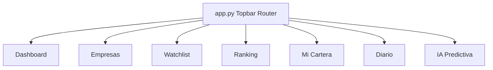

# INFORME TÉCNICO DE AUDITORÍA INTEGRAL — STOCKLAB (FASE 1)

**Fecha de ejecución:** 1 de Agosto de 2026  
**Proyecto:** StockLab (Investment Terminal)  
**Estado del código:** 100% Intacto (Sin modificaciones en archivos fuente de la aplicación)  

---

## 1. Resumen Ejecutivo

**StockLab** es una plataforma web financiera interactiva basada en **Streamlit** y desarrollada en **Python**, diseñada para el análisis cuantitativo de empresas, seguimiento de carteras de inversión (Simuladas y Reales), evaluación mediante Inteligencia Artificial / Machine Learning (Random Forest) y visualización gráfica avanzada de datos de mercado en tiempo real (BME / Mercado Continuo español).

### Estado General del Proyecto
- **Funcionamiento y Estabilidad:** La aplicación se encuentra en un estado funcional avanzado. Posee un sistema de diseño visual muy cuidado (Dark Terminal SaaS con paletas HSL y tipografías Inter/JetBrains Mono) y un motor gráfico unificado en Chart.js 4.4.0.
- **Madurez Arquitectónica:** Presenta una estructura modular bien delimitada por capas (`views/`, `services/`, `database/`, `components/`, `utils/`). Sin embargo, acumula **deuda técnica importante** producto de iteraciones anteriores.
- **Hallazgos Clave:**
  1. **Código Huérfano y Redundante:** Existen vistas totalmente en desuso y desvinculadas del enrutador principal (`views/dashboard_head.py` de ~40 KB y `views/configuracion.py`), además de scripts auxiliares sueltos en el directorio raíz (`check_market.py`, `limpiar_tickers.py`).
  2. **Duplicación de Motores de Scoring:** Se han detectado al menos 3 implementaciones diferentes del algoritmo de puntuación (en `utils/scoring.py`, `services/ranking_engine.py` y llamadas internas en `views/ranking.py`), lo que genera riesgo de divergencia cuantitativa.
  3. **Riesgo en Inicialización de Base de Datos:** El método `seed_companies()` ejecuta un `DELETE FROM empresas` incondicional durante la inicialización en `database/connection.py`, lo que representa un riesgo para la integridad referencial de la tabla `cartera` (clave foránea con `ON DELETE CASCADE`).
  4. **Acumulación de Documentación y Archivos Temporales:** El directorio raíz contiene 18+ archivos Markdown de informes pasados, logs de trazabilidad en `.txt` y archivos de depuración `scratch_*` que recargan la estructura sin aportar valor en runtime.

---

## 2. Arquitectura General

```
stock-lab/
├── app.py                     # Punto de entrada principal y enrutador topbar
├── config.py                  # Single Source of Truth para variables de entorno (.env)
├── market_data.py             # Capa de datos de mercado con yfinance y caché Streamlit
├── stocklab.db                # Base de datos SQLite
├── components/                # Componentes de UI reutilizables
│   └── stock_chart.py         # Motor gráfico oficial en Chart.js 4.4.0 (iframe)
├── database/                  # Capa de persistencia
│   ├── connection.py          # Conexión SQLite, esquemas y seeding
│   ├── cartera.py             # Operaciones y cálculos de patrimonio/liquidez
│   └── watchlist.py           # Gestión CRUD de empresas en seguimiento
├── services/                  # Motores de negocio y backend
│   ├── data_provider.py       # Cascada de datos (Yahoo -> FMP -> Finnhub -> Fallback)
│   ├── fundamental_data.py    # Wrapper de datos fundamentales y sentimiento
│   ├── ranking_engine.py      # Motor de scoring cuantitativo (Calidad, Oportunidad, Score Final)
│   ├── ia_engine.py           # Predicción ML (Random Forest) y cálculo técnico (RSI/MACD)
│   ├── alert_engine.py        # Motor centralizado de alertas del sistema
│   └── auditor_pipeline.py    # Módulo de diagnóstico de trazabilidad
├── utils/                     # Utilidades transversales
│   └── scoring.py             # Funciones de scoring complementarias / legacy
├── views/                     # Capa de presentación (Páginas / Secciones)
│   ├── dashboard.py           # Vista principal (Resumen, Movers, Eventos, Alertas)
│   ├── dashboard_head.py      # [HUÉRFANO] Versión legacy del Dashboard
│   ├── empresas.py            # Ficha técnica detallada por empresa
│   ├── watchlist.py           # Tabla e indicadores de empresas en seguimiento
│   ├── ranking.py             # Ranking cuantitativo BME
│   ├── mi_cartera_v2.py       # Gestión de patrimonio (Simulada vs Real)
│   ├── diario.py              # Diario de trading / notas del inversor
│   ├── ia.py                  # Terminal de proyección ML y análisis predictivo
│   └── configuracion.py       # [HUÉRFANO] Stub sin implementar
└── data/                      # Almacenamiento de caché y JSON oficial
    ├── dividendos_oficiales.json
    └── cache/                 # Archivos CSV/TXT de caché en disco
```

### Responsabilidades por Módulo
- **Enrutador (`app.py`):** Configura el layout `wide`, oculta la sidebar nativa e inyecta la barra superior (Topbar) construida con botones nativos de Streamlit con CSS avanzado.
- **Vistas (`views/`):** Construyen la interfaz dividida en 7 secciones funcionales. Interactúan directamente con `services/` y `database/`.
- **Servicios (`services/`):** Aíslan la lógica compleja. Destaca `data_provider.py` que implementa una cascada tolerante a fallos para obtención de datos financieros.
- **Componentes (`components/stock_chart.py`):** Encapsula el gráfico financiero interactivo usando Chart.js, cruz de seguimiento (crosshair), herramienta de medición drag-to-measure y zoom con HammerJS.

---

## 3. Flujo de Navegación

### Navegación Principal (Topbar)
La navegación se gestiona mediante la variable de sesión `st.session_state["menu_activo"]`.



1. **Dashboard:** Métrica de patrimonio global, alertas del sistema, índices/movers de mercado y calendario de eventos corporativos.
2. **Empresas:** Buscador de tickers y ficha analítica individual (Gráficos, Ratios, Análisis fundamental, Acciones de compra/Watchlist).
3. **Watchlist:** Seguimiento de precios objetivo (Estrategias: `COMPRA_EN_CAIDA` o `COMPRA_EN_RUPTURA`).
4. **Ranking:** Tabla de clasificación de empresas del BME según Scores de Calidad (0-100) y Oportunidad (0-100).
5. **Mi Cartera:** Gestión patrimonial dual (Cartera Simulada vs Cartera Real), control de liquidez, historial de transacciones e métricas de rentabilidad.
6. **Diario:** Registro personal de notas y reflexiones de mercado asociadas a sentimientos (Alcista, Bajista, Neutral).
7. **IA:** Terminal de proyecciones basadas en Random Forest Regressor y análisis técnico.

### Navegación Secundaria / Cruzada
- Desde **Watchlist**, **Ranking** o **Mi Cartera**, hacer clic en un ticker o botón "Ver Ficha" establece `st.session_state["ticker_seleccionado"]` y cambia `st.session_state["menu_activo"] = "Empresas"`, redirigiendo automáticamente a la vista de detalle.
- Soporte para parámetros URL mediante `st.query_params.get("page")`.

---

## 4. Dependencias

### Dependencias Externas (Librerías Python)
- **`streamlit`**: Framework principal de interfaz.
- **`yfinance`**: Fuente primaria de datos de mercado y cotizaciones intradía/diarias.
- **`pandas` & `numpy`**: Manipulación de series temporales y estructuras matriciales.
- **`scikit-learn`**: Entrenamiento del modelo `RandomForestRegressor` y normalización con `StandardScaler`.
- **`python-dotenv`**: Carga de variables de entorno desde `.env`.
- **`requests`**: Peticiones HTTP directas a APIs externas y Yahoo Finance.
- **`plotly`**: Importada en algunos módulos (ej. `dashboard_head.py`), pero sustituida en el motor principal por Chart.js.
- **`ta-lib`**: Declarada en `requirements.txt`, pero **no es utilizada en el código Python** (los indicadores técnicos RSI, MACD, SMA se calculan de forma nativa con pandas/numpy).

### Dependencias entre Módulos Internos
- `views/` depende de `services/`, `database/`, `components/` y `market_data.py`.
- `services/` depende de `config.py`, `database/` y `market_data.py`.
- `database/` no tiene dependencias cruzadas con `services/` ni `views/` (capa limpia).

---

## 5. Recursos del Proyecto

### Recursos en Uso Activo
- `stocklab.db`: SQLite con 8 tablas (`mercados`, `empresas`, `watchlist`, `cartera`, `notas`, `diario`, `eventos`, `ranking_estado`).
- `data/dividendos_oficiales.json`: Catálogo oficial de eventos de dividendos.
- `data/cache/`: Archivos de caché de sincronización y descargas históricas CSV.

### Recursos Candidatos a Limpieza (Sin uso en Runtime)
1. **Documentación Markdown acumulada en la raíz (18 archivos):**
   - `ANALISIS_COMPLETO_PROYECTO.md`
   - `ANTES_DESPUES.md`
   - `AUDITORIA_TECNICA_COMPLETA.md`
   - `CODIGO_OPTIMIZADO.md`
   - `DIFF_CODIGO.md`
   - `INDICE_MAESTRO.md`
   - `INFORME_CERTIFICACION_PIPELINE_FASE1.3.md`
   - `INFORME_SISTEMA_PUNTUACIONES.md`
   - `INTEGRACION_ML_IA.md`
   - `OPTIMIZATION_SUMMARY.md`
   - `PLAN_INTEGRACION_ORGANICA.md`
   - `QUICK_REFERENCE.md`
   - `README_OPTIMIZACION.md`
   - `RESUMEN_FINAL.md`
   - `VERIFICATION_CHECKLIST.md`
   - `walkthrough.md`
   - `task.md`
2. **Archivos de registro / depuración / scratch:**
   - `AUDITORIA_TRAZABILIDAD_RESULTADOS.txt`
   - `scratch_debug.html`
   - `scratch_debug.py`
   - `scratch_diff.txt`
   - `scratch/` (directorio borrador)
3. **Scripts de una sola ejecución:**
   - `limpiar_tickers.py` (script puntual de corrección del IBEX 35).
   - `check_market.py` (script de diagnóstico CLI).

---

## 6. Código: Análisis de Calidad y Redundancias

### Código Muerto o Huérfano
- **`views/dashboard_head.py` (39.6 KB):** Archivo completo de vista que fue sustituido por `views/dashboard.py`. No se importa en `app.py` ni en `views/__init__.py`.
- **`views/configuracion.py` (285 B):** Vista incompleta de 8 líneas. En `app.py`, la opción "Configuración" está redireccionada a "Dashboard".
- **`services/ranking_engine.py` (`_calcular_score_calidad_legacy`, `_calcular_score_oportunidad_legacy`):** Funciones antiguas etiquetadas con `[DEPRECATED]`.

### Duplicación de Lógica (Scoring)
Se han identificado 3 lugares donde se calcula o desglosa la lógica de puntuación:
1. `utils/scoring.py` (`calcular_score_completo`): Fórmula basada en Calidad (30), Valoración (25), Momentum (20), Dividendos (15), Seguridad (10).
2. `services/ranking_engine.py` (`calcular_score_calidad`, `calcular_score_oportunidad`): Fórmula de Calidad (100) y Oportunidad (100) ponderados al 60/40.
3. `views/ranking.py` (`_calcular_calidad_empresarial`, `_calcular_oportunidad_inversion`): Funciones auxiliares locales para el renderizado del acordeón UI.

### Redundancia de Sesiones HTTP
`market_data.py`, `views/dashboard.py`, `views/empresas.py` y `services/data_provider.py` instancian individualmente objetos `requests.Session()` con cabeceras idénticas para evadir bloqueos de Yahoo Finance.

---

## 7. Calidad General del Proyecto

| Criterio | Valoración (1-10) | Justificación |
| :--- | :---: | :--- |
| **Arquitectura** | **7.5 / 10** | Clara separación por capas (`views`, `services`, `database`, `components`), pero mermada por código huérfano. |
| **Organización** | **6.5 / 10** | El código activo está bien ubicado, pero la raíz del proyecto sufre saturación por 20+ archivos MD/TXT. |
| **Modularidad** | **7.5 / 10** | Excelente desacoplamiento del componente gráfico `stock_chart.py` y la capa `data_provider.py`. |
| **Legibilidad** | **8.5 / 10** | Código limpio, tipado progresivo en funciones clave, comentarios explicativos en español y buena estructura. |
| **Escalabilidad** | **7.0 / 10** | Buen uso de caché Streamlit (`@st.cache_data`) y peticiones concurrentes, aunque SQLite y estilos inline dificultan escalar UI masivas. |
| **Mantenibilidad**| **7.0 / 10** | La duplicación de funciones de scoring dificulta actualizar reglas de negocio sin riesgo de inconsistencia. |
| **Reutilización** | **8.0 / 10** | El motor `render_stock_chart` y la gestión de conexiones SQLite son altamente reutilizables. |
| **Consistencia Visual** | **9.0 / 10** | Estética terminal SaaS de muy alto nivel, paleta de colores coherente y acabados profesionales. |
| **Consistencia de Código** | **7.5 / 10** | Convenciones de nombres sólidas, aunque coexisten formatos snake_case y camelCase en diccionarios fundamentales. |
| **Complejidad Técnica** | **8.5 / 10** | Integración de ML (`RandomForestRegressor`), indicadores técnicos cuantitativos, motor de alertas y Chart.js interactivo. |

---

## 8. Riesgos Identificados

> [!CAUTION]
> **Riesgo Crítico 1: Vaciado de tabla `empresas` en boot (`database/connection.py`)**  
> La función `seed_companies()` ejecuta `DELETE FROM empresas` al iniciar la app. Aunque se repuebla inmediatamente con `INSERT OR IGNORE`, en SQLite este vaciado puede desencadenar la eliminación en cascada de operaciones registradas en `cartera` si `PRAGMA foreign_keys = ON` está activado, o causar pérdida de coherencia de claves primarias `id`.

> [!WARNING]
> **Riesgo 2: Trazabilidad de Scopes y Desajuste en Scores**  
> Al existir múltiples motores de scoring, cualquier modificación futura en una regla de valoración en `services/ranking_engine.py` que no se replique en `utils/scoring.py` provocará inconsistencias en los datos mostrados entre el Dashboard, la Ficha de Empresa y la vista de Ranking.

> [!WARNING]
> **Riesgo 3: Bloqueos y Límite de Tasa (Rate Limit) en APIs de Terceros**  
> Las peticiones a Yahoo Finance dependen de la estabilidad de los endpoints no oficiales. Si Yahoo aplica un bloqueo agresivo por IP o cambia sus estructuras de respuesta, las vistas caen a los niveles de fallback.

> [!NOTE]
> **Riesgo 4: Estilos CSS Globales Elevados**  
> En `app.py` se inyectan reglas CSS globales con `!important` para modificar el comportamiento de los botones de la topbar. Cualquier ajuste en componentes de vistas secundarias que use `st.button` podría heredar o colisionar con estos estilos.

---

## 9. Recomendaciones y Hoja de Ruta (Fases Posteriores)

*Nota: Ninguna de estas recomendaciones ha sido ejecutada en la presente Fase 1.*

### Fase 2: Limpieza y Consolidación (Propuesta)
1. **Archivo de recursos inutilizados:** Mover los 18+ archivos Markdown e informes antiguos a una carpeta de archivo (ej. `docs/archive/`) para despejar la raíz del repositorio.
2. **Eliminación de código huérfano:** Eliminar de forma segura `views/dashboard_head.py` y `views/configuracion.py` tras verificar cero referencias.
3. **Desactivar `DELETE` en seeding:** Modificar `seed_companies()` para usar únicamente `INSERT OR IGNORE` sin vaciar la tabla previamente.

### Fase 3: Refactorización y Optimización (Propuesta)
1. **Unificación del Motor de Scoring:** Centralizar el 100% de los cálculos de scoring en `services/ranking_engine.py` y eliminar código redundante en `utils/scoring.py` y `views/ranking.py`.
2. **Sesión HTTP Centralizada:** Crear una utilidad única de peticiones HTTP en `services/data_provider.py` reutilizable por todos los módulos.
3. **Limpieza de `requirements.txt`:** Eliminar `ta-lib` si se confirma que los indicadores técnicos se mantendrán con numpy/pandas.

---

*Fin del Informe de Auditoría Técnica Integral (FASE 1).*
